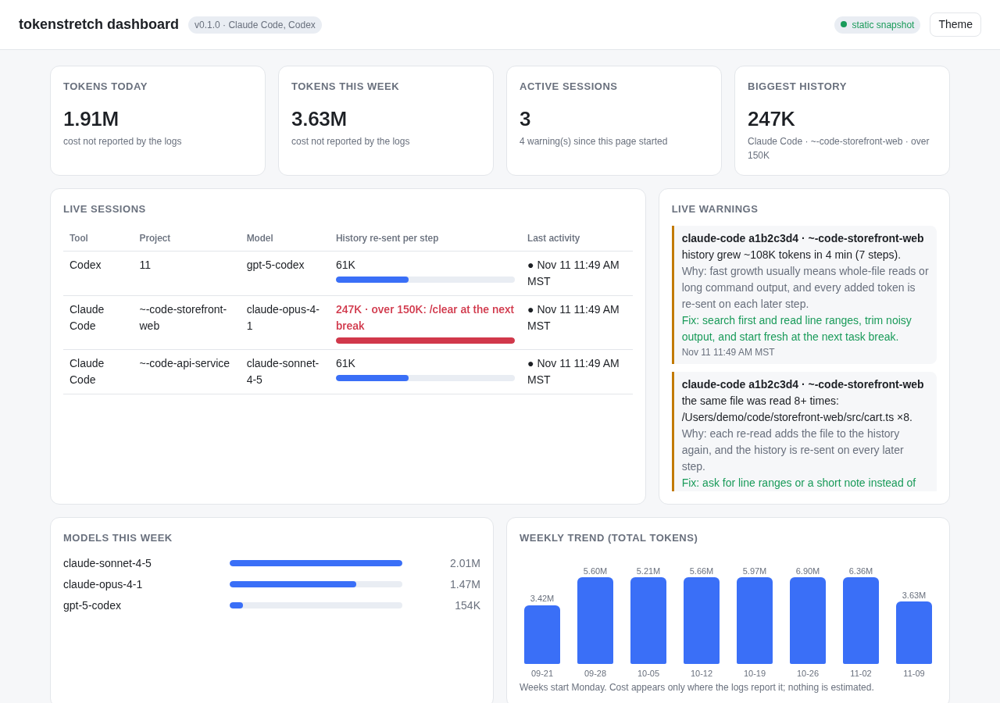
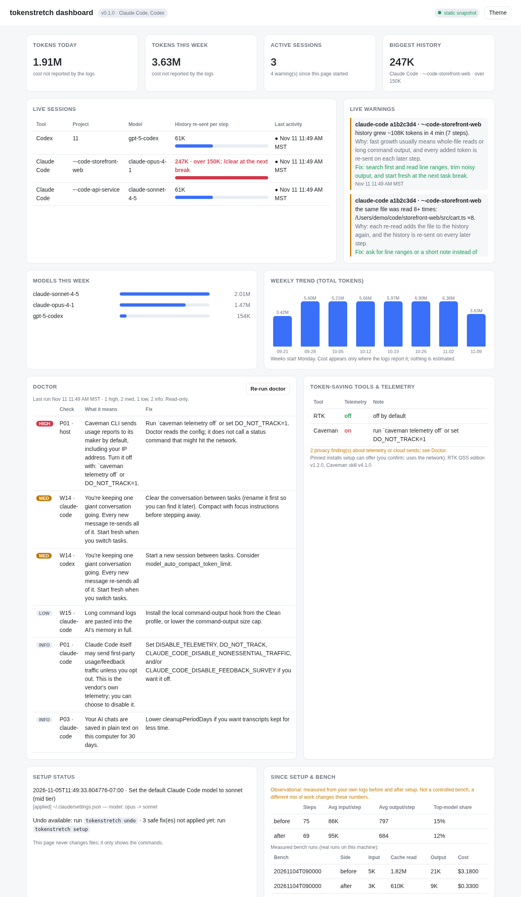

# tokenstretch

**Stop paying for wasted AI coding credits. One command finds the waste, explains it, and fixes it, with undo.**

tokenstretch is **free and open source (MIT)**. It runs **100% on your machine**. There's no account, no sign-up, no telemetry, and no server. It looks at how Claude Code, Codex, and other coding agents are set up on your computer, shows you in plain English where your credits are going, and applies a small set of safe fixes. It backs up every file first, and `tokenstretch undo` puts everything back.

It doesn't replace your tools. It checks, configures, and measures them, including RTK and Caveman.

### Support tokenstretch

tokenstretch is free and stays free, with no paid tier and no tracking. If it saves you credits and you'd like to say thanks:

- [Buy me a coffee on Ko-fi](https://ko-fi.com/exjtac)
- Bitcoin (on-chain): `bc1qt892nv80l50grylqddnzf9u4203gm2gqmr22ku`


Stars, bug reports, and pull requests help just as much.



<sub>The local dashboard (`tokenstretch dashboard`), shown with sample data.</sub>

## What you get

- **A plain-English checkup.** `doctor` runs 40+ local checks: the top model set as your everyday default, giant sessions that re-read hundreds of thousands of tokens on every step, duplicate instruction files you pay for twice, telemetry quietly left on, proxy chains, and setups that risk your provider's terms.
- **Fixes it applies for you.** `setup` explains each change (what it is, why it costs you, which file and key it touches, and how to undo it), asks once, then applies it with live progress.
- **A painless fresh start.** `/handoff` has the agent write a short note before you `/clear`, and `/handoff resume` picks the task up in the new session, so clearing a long session no longer costs you the context.
- **A live view.** `status` shows what's applied, which model each tool defaults to, and how much history your newest sessions re-read on every step. It flags sessions over ~150K tokens with a "`/clear` at the next task break" tip.
- **A live watch.** `watch` runs quietly in a terminal and warns you, once per problem, when a session's history gets too big, the top model is doing simple steps, the same file keeps getting re-read, history is growing fast, or a pause let the saved-context discount expire. Each warning says what's wrong, why it costs credits, and the one-line fix.
- **A status-bar line.** `statusline` shows the current session's history size and the most urgent warning inside your tool's own status bar, so you don't need a second terminal.
- **An instruction-file trimmer.** `trim` lists every instruction file your agents resend on each turn (CLAUDE.md, AGENTS.md, GEMINI.md, copilot-instructions.md, and their imports) with approx. token counts, finds duplicated rules, oversized files, pasted logs and code, and stale paths, and proposes a trimmed version that only makes safe mechanical changes. It's a dry run unless you pass `--apply`, and `undo` restores it.
- **A brief writer.** `brief "<task>"` turns a one-line task into a brief that names the files, the notes to work from, what not to do again, the stop condition, and the reply length, and lists what your task leaves open.
- **A model and effort picker.** `model suggest "<task>"` recommends light, mid, or top for a task, a reasoning effort to go with it, and names the model for each tool you have. `model default --tier mid` changes your default model, with a backup and undo.
- **A shareable report.** `report` writes a single self-contained HTML file with the findings, the plan, what was applied, undo commands, and current status. It loads nothing from the internet.
- **A weekly report.** `report --weekly` adds up your local usage logs per week: tokens by type and by model, your biggest session histories, waste spots, and a before/after view since setup. Cost appears only where your logs report it.
- **A local dashboard.** `dashboard` opens one live page on your own machine with all of the above, updated every 5 seconds. See [Dashboard](#dashboard).
- **Real measurements, never guesses.** `bench` compares before and after on a throwaway copy of your repo, using your agent's own usage logs. If there's no data, it says `no measurement`.
- **Full undo.** Every changed file is backed up under `~/.tokenstretch/backups/`, and each change is recorded in a manifest.

## Install

One line, for macOS or Linux with Python 3.11 or newer:

```bash
curl -fsSL https://raw.githubusercontent.com/ExJtac/tokenstretch/main/scripts/install.sh | sh
```

Or inspect it first (recommended): download it, read it, preview it, and then run it:

```bash
curl -fsSLo install.sh https://raw.githubusercontent.com/ExJtac/tokenstretch/main/scripts/install.sh
less install.sh                 # the pinned tag and commit are at the top
sh install.sh --dry-run         # prints every step; downloads and changes nothing
sh install.sh
```

What the installer does:
- It installs one pinned release, never "latest". The tag and commit are written at the top of the script. With git, it clones the pinned tag and refuses if the tag doesn't point at the pinned commit. Without git, it downloads that commit's tarball and refuses unless its SHA-256 matches the pinned hash. That fetch is its only network use.
- It installs into its own folder, `~/.local/share/tokenstretch`, with a private venv made by `python -m venv --without-pip`. tokenstretch has no dependencies, so there's no pip and nothing from PyPI.
- It adds a `tokenstretch` launcher in `~/.local/bin`.
- It never edits your shell startup files unless you pass `--add-to-path`, and it backs them up first when you do.
- It never runs `setup` or installs other tools. There's no telemetry and no install ping.

`sh install.sh --uninstall` removes exactly what it created: the folder, the launcher, and the PATH line. Your `~/.tokenstretch` backups stay, so run `tokenstretch undo` first if you want setup's changes reverted.

Options: `--add-to-path`, `--python PATH`, `--data-dir DIR`, `--bin-dir DIR`, `--dry-run`, `--uninstall` (`sh install.sh --help` lists them). For an install link that can never change, use the commit link in the release notes instead of `main`. The installer doesn't use pipx, because pipx would download build tools from PyPI. To install from a clone instead, see the quickstart.

## 30-second quickstart

```bash
pip install .                # from a clone of this repo; Python 3.11+, no dependencies
cd ~/your-project
tokenstretch setup           # explains the plan, asks [y/N], applies with backups
tokenstretch setup --list    # the steps available here, each with its id (changes nothing)
tokenstretch setup --only claude-credits-skill   # apply one step; --skip <id> leaves one out
tokenstretch status          # what's on now, plus your newest sessions
tokenstretch report          # writes a local HTML report and prints its path
tokenstretch watch           # live warnings while you work (Ctrl-C to stop)
tokenstretch statusline      # the same checks as one line, for your tool's status bar
tokenstretch dashboard       # live local page in your browser (Ctrl-C to stop)
tokenstretch report --weekly # weekly usage roll-up as a local HTML file
tokenstretch model suggest "fix the flaky login test"
tokenstretch trim            # what your instruction files cost per turn, and a safe trim (dry run)
tokenstretch undo            # restores everything the last setup changed
```

`python -m tokenstretch setup` works too. With no terminal to ask in (CI, pipes), `setup` is a **dry run** unless you pass `--yes`. Use `--dry-run` to preview anywhere.

Sample (trimmed):

```
Plan (3 changes, all local, every file backed up first):
  2. Make sonnet the default Claude Code model
     Why: Your default is opus (from ~/.claude/settings.json). The top model costs several times more per step. ...
     Changes: edit ~/.claude/settings.json (key: model; model: opus -> sonnet)
     Undo: `tokenstretch undo`
     Note: For hard tracing or design work, type `/model opus` in Claude Code, then `/model sonnet` when done.
Apply these 3 change(s)? [y/N] y
✔ switched default model to sonnet, backed up ~/.claude/settings.json → ~/.tokenstretch/backups/…/home/.claude/settings.json
```

## What setup changes, and how to undo it

Setup only proposes a change when it applies to your machine, and it always shows the exact file and key first.

You don't have to take the whole plan. Each step has an id, shown in [brackets] in the plan and by `tokenstretch setup --list`. `setup --only <id>` applies that one step and `setup --skip <id>` leaves one out; both take several ids, repeated or separated by commas. `--only` skips the checkup summary, so it is quick. A step that would start a new file in your project (a `CLAUDE.md` or `AGENTS.md` that doesn't exist yet) is optional: the plan lists it, and it's applied only when you ask for it with `--only`.

| Change | File | Why |
|---|---|---|
| Default Claude Code model → `sonnet` (only if the default is Opus/Fable or unset) | `~/.claude/settings.json` (or the project settings file that sets `model`), key `model` | The top model costs several times more per step. You can still use it for hard work with `/model opus`. |
| 5 short credit-saving rules: start each task fresh, read narrowly, don't re-read, run subagents on the mid-tier model, keep replies short | project `CLAUDE.md` (and `AGENTS.md` if Codex is installed; an existing `GEMINI.md` for Gemini CLI or `.github/copilot-instructions.md` for Copilot CLI, unless Copilot already loads a rules block from `AGENTS.md`/`CLAUDE.md`/`GEMINI.md`), in a marked block. Setup never creates a new Gemini or Copilot instruction file. | Long sessions re-read their whole history on every step. |
| Credit warnings inside Claude Code: the status line, and a prompt hook that shows the top warning in the session (only if they are not already there; an existing status line is kept and wrapped, see [In your status bar](#in-your-status-bar)) | `~/.claude/settings.json`, keys `statusLine` and `hooks.UserPromptSubmit` | Warnings only help if you see them while you work. After this, every Claude Code session shows them with nothing to run by hand. |
| Autopilot for Claude Code: summarize long sessions at about 200K tokens, shape and save the summary, and point a new chat at it (each part only if you haven't set it yourself; see [Autopilot](#autopilot-shorter-sessions-with-nothing-to-type)) | `~/.claude/settings.json`, keys `env.CLAUDE_CODE_AUTO_COMPACT_WINDOW` and `hooks.PreCompact`, `hooks.PostCompact`, `hooks.SessionStart` | Nobody has to remember `/clear`. |
| A `/credits` shortcut for Claude Code (only if no `credits` skill or command exists) | new file `~/.claude/skills/credits/SKILL.md` | The start-up and waste checks without a terminal: the agent runs `startup` and `watch --once` and reports in plain words. After you say yes to one fix, it runs `setup --only <id> --yes` for that step, with the same backup and undo. An older copy written by this tool is updated; a `/credits` of your own is never touched. |
| A `/brief` shortcut for Claude Code (only if no `brief` skill or command exists) | new file `~/.claude/skills/brief/SKILL.md` | The brief writer without a terminal; see [Write a brief that stays cheap](#write-a-brief-that-stays-cheap). |
| A `/handoff` shortcut for Claude Code (only if no `handoff` skill or command exists, in your home folder or the project) | new file `~/.claude/skills/handoff/SKILL.md` | `/clear` is the cheapest fix for a long session, but the agent forgets the task. `/handoff` writes a short note first; see [Start fresh without losing the task](#start-fresh-without-losing-the-task). |
| Gemini CLI usage statistics off | `~/.gemini/settings.json`, key `privacy.usageStatisticsEnabled` | It defaults to on and sends usage statistics to Google. |
| Caveman telemetry off | `~/.caveman/cloud.json`, key `telemetry.enabled` | The Caveman CLI reports usage, including your IP, by default. |
| RTK telemetry back off (only if someone turned it on) | `~/.config/rtk/config.toml`, key `telemetry` | Privacy. |
| *Optional, asked separately because it downloads:* pinned installs of RTK OSS v1.2.0 (`RTK_EDITION=oss`, commit `e288a18`) and the Caveman **skill only** v4.1.0 (commit `1e91f13`) | pinned in `tokenstretch/catalog.py` | Shell-output compression and terse replies, from pinned, hash-checked sources. |

To undo, run **`tokenstretch undo`**. It restores every file from the latest setup run, newest step first, and deletes files that setup created. If you've edited a file since then, undo stops and tells you, unless you pass `--force`. To undo a single step, pass that step's manifest from `~/.tokenstretch/manifests/`.

Shell rc files are never edited. If `ANTHROPIC_MODEL` is set in your shell, setup tells you rather than changing it.

## Watch while you work

`tokenstretch watch` re-reads your local session logs every 10 seconds (`--interval`) and prints a warning the first time a session shows one of these. It never repeats a warning for the same session.

| Warning | Why it costs credits | Fix it suggests |
|---|---|---|
| History over 150K tokens (`--max-context`) | Every step re-sends the whole conversation. | `/clear` (fresh start) or `/compact` |
| Top model on the last 3 simple steps (short replies, few tool calls) | The top model costs several times more per step. | `/model sonnet` for routine steps |
| The same file read 3+ times (`--max-reads`) | Each re-read is added to history and re-sent. | Ask for line ranges or a note; start fresh |
| History grew 60K+ tokens in 5 minutes | Big reads or noisy output pile up fast. | Read narrowly, trim output |
| Helpers (subagents) re-sent 1M+ tokens and more than the main conversation | Each helper is its own conversation with its own start-up size, re-sending its history on every step. | One narrow task per helper, name the files to work from, ask for a short reply |
| Finished helpers woke the conversation 3+ times (`--wake-min`) and those steps re-sent 300K+ tokens | Each background helper that finishes starts a new step, and that step re-sends the whole conversation. | Start helpers early and together; one final report, not one per helper |
| 2+ helpers ran at `xhigh` or `max` effort and re-sent 500K+ tokens (Claude Code logs record the effort) | A higher effort lets the model think longer on every step, and thinking is billed as output. | Lower effort for routine helpers; keep the top effort for the hard step |
| The session started at 40K+ tokens before any work (`--max-start`) | Instruction files, tool and connector definitions, and skill listings are re-sent on every step of every session. `/clear` doesn't remove them. | `tokenstretch trim`; turn off unused connectors and skills (`doctor` W03, W25) |
| The saved-context discount (prompt cache) expired during a pause | The next message re-pays for the whole conversation instead of the discounted re-read. | `/clear` before a break; start fresh instead of resuming a big idle session |

```
⚠ [claude-code abcd1234 · -Users-me-app] history is ~200K tokens (over 150K).
   Why it costs credits: every step re-sends the whole conversation, so each reply now costs at least that much input.
   Fix: finish this step, then type /clear (fresh start) or /compact (keeps a short summary).
```

When the session's start-up size is known, the long-history warning also says about how many more steps it takes for a fresh start to pay for itself: roughly two steps at the current size, divided by what each later step saves (current size minus start-up size). It's a rule of thumb from token counts, not a price calculation.

The cache warning comes in two forms. If the logs already show it (after a pause of 5+ minutes, the same model re-wrote most of the history to the cache and read almost none back), watch reports how often and how many tokens. If a session with 20K+ tokens of history is sitting idle past the cache lifetime right now (about an hour on a Claude subscription, about five minutes with an API key or a 5-minute cache setting), watch says the discount has probably expired, so you can `/clear` before your next message. That second form is a prediction from the clock, and it says so. Claude Code only for now.

It's read-only and only looks at token counts, model names, tool-call counts, and the paths of files the agent read (never their contents). `--once` does a single pass. `--notify` also pops a desktop notification through your OS's own `osascript` or `notify-send`, if present. Claude Code is fully supported. Codex gets the history, top-model, and growth warnings (its logs don't record file reads). Other tools say "not supported yet".

## Autopilot: shorter sessions with nothing to type

Most people will never type `/clear` or `/handoff`, so `tokenstretch setup` also sets Claude Code up to do the same job by itself:

1. **Long sessions are summarized automatically at about 200K tokens.** Setup sets `CLAUDE_CODE_AUTO_COMPACT_WINDOW=200000` under `env` in `~/.claude/settings.json`. Without it, a model with a large context window can carry several hundred thousand tokens on every step before anything trims it.
2. **The automatic summary is written as a note you could resume from.** A `PreCompact` hook tells the summary what to keep (goal, what's done and how it was checked, files and branch, decisions, next step, open questions) and what to drop (file contents, command output, search results).
3. **The summary is saved** to `.claude/handoff-auto.md` in the project by a `PostCompact` hook.
4. **The work restarts by itself after a summary.** The same `SessionStart` hook fires after a compaction and tells the agent to carry on with the summary's next step in the same turn, without stopping to report or asking for a go-ahead. Anything waiting on you still waits.
5. **A new chat picks the work up.** A `SessionStart` hook tells the agent where the newest note is (that file, or the one `/handoff` writes) if it's less than 72 hours old. Say anything ("continue", "what's happening?") and the agent reads the note, tells you where things stand in a few lines, and does the next step without asking you to say go. Ask for something else and the note is left unread. Things the note lists as waiting on you still wait. You do have to send that one message: Claude Code doesn't let a hook start the first turn of an interactive chat.

While autopilot is on, `watch`, the status line and the in-session warning stay quiet about long history below the automatic size: no tip to `/clear` by hand contradicts it. A session that is well past that size (it started before setup, so the setting never reached it) gets one tip instead: type `/compact` once.

The three hooks are one command, `tokenstretch auto`. It makes no model calls, reads only what Claude Code passes it, never follows a link when writing, always exits 0, and its hook command ends in `|| true`, so it can't block a session, a prompt, or a compaction. Add `.claude/handoff-auto.md` to `.gitignore` if you don't want it committed.

Setup leaves your own choices alone: if you already set `CLAUDE_CODE_AUTO_COMPACT_WINDOW`, `CLAUDE_AUTOCOMPACT_PCT_OVERRIDE`, `DISABLE_AUTO_COMPACT`, `autoCompactWindow`, or turned `autoCompactEnabled` off, the size isn't touched. To use a different size, change the number in `settings.json` (Claude Code accepts 100000 to 1000000).

What this costs: each automatic summary is one model step over the history, and a summary keeps less detail than the full history. What it saves: every step after it re-sends a short note instead of 200K or more. This is built on Claude Code's documented settings and hook events; the unit tests cover the hook and setup logic, and the hooks have been watched on one live automatic compaction: a 283K history came back as a 20K summary in the handoff shape, and the note was saved to disk. That session began before the size setting was written, so a compaction at the 200K size, in a session started after setup, has not yet been watched.

## Start fresh without losing the task

Every step re-sends the whole conversation, so the biggest saving is a fresh session. Most people don't take it, because the agent then forgets what it was doing. Setup adds a `/handoff` shortcut to Claude Code that removes that cost:

```text
/handoff           the agent writes .claude/handoff.md: goal, what's done, files changed, decisions, next step
/clear             fresh session
/handoff resume    the agent reads the note and carries on from "Next step"
```

The note is at most 40 lines, written from what the agent already knows (it's told not to read files or run commands for it), so the handoff itself is one cheap step. After `/clear` you re-send a page instead of the whole history.

The shortcut is a manual-only skill (`disable-model-invocation: true`), so it adds nothing to each turn and the agent never runs it on its own. Once it's installed, `watch` and `statusline` say `/handoff then /clear` instead of `/clear`. Setup never replaces a `handoff` skill or command you already have, and `tokenstretch undo` deletes the file. The note lives in the project's `.claude/` folder; add `.claude/handoff.md` to `.gitignore` if you don't want it committed. Claude Code only for now. The saving isn't measured yet: it depends on how often you clear.

## In your status bar

`watch` needs its own terminal. `tokenstretch statusline` puts the same checks where you're already looking: it prints one line with the current session's history size and, if watch would warn, the most urgent warning.

```text
22K/150K history · claude-sonnet-5-5
⚠ 158K/150K history · /clear at the next task break
⚠ 104K/150K history · cache expired after ~50 min idle (~99K re-sent): /clear before breaks
```

For Claude Code, `tokenstretch setup` adds it for you (shown first, backed up, undone by `tokenstretch undo`). If you already have a status line, setup keeps it and wraps it. To add it by hand instead, put this in `~/.claude/settings.json`:

```json
{ "statusLine": { "type": "command", "command": "tokenstretch statusline" } }
```

Already have a status line from another tool, such as Caveman's? A tool has one status-line slot, so share it with `--wrap`. Put your current command inside it:

```json
{ "statusLine": { "type": "command", "command": "tokenstretch statusline --wrap 'bash ~/.claude/hooks/caveman-statusline.sh'" } }
```

The wrapped command gets the same input and prints as before, and tokenstretch adds its line to the end of the first line (`[CAVEMAN] · 22K/150K history · claude-sonnet-5-5`). If the wrapped command fails or takes over 3 seconds, you get the tokenstretch line alone; if tokenstretch has nothing to say, you get the other line unchanged.

Claude Code pipes the session's log path to the command, and `statusline` reads that one file. It only opens a `.jsonl` file inside `~/.claude/projects`; any other path prints nothing. Run by hand, it uses your newest active session. It's read-only, runs no other program unless you pass `--wrap`, and takes about a tenth of a second. If anything goes wrong it prints nothing and exits 0, so it can't break your status bar. `--max-context` and `--max-reads` work as in `watch`.

### In the session itself

Setup also adds a prompt hook, `tokenstretch nudge`. When you send a prompt and the session has a warning, Claude Code shows it in the chat and passes it to the agent, which is told to finish your request first and then mention it in one line. This is what makes the warnings reach sessions nobody is watching, such as agents working in the background.

- No warning, no output, so a clean session pays nothing.
- The same kind of warning is repeated at most every 20 minutes per session.
- It reads the one session log Claude Code names (token counts, never prompt text), always exits 0, and can't block a prompt (the hook command ends in `|| true`, so even a broken install can't).
- It keeps one small file per session in `~/.tokenstretch/nudge/` to remember what it last said. Files older than a week are removed.

## Dashboard

```bash
tokenstretch dashboard            # opens http://127.0.0.1:8765/<one-time key>/ in your browser
tokenstretch dashboard --no-open  # just print the link; --port 9000 to pick a port
```

One page, refreshed every 5 seconds while it runs:



- **Overview:** tokens today and this week, cost (only if your logs report it), active sessions, and the biggest history.
- **Live sessions:** tool, project, model, and history size with a bar against the 150K mark.
- **Live warnings:** the same once-per-problem warnings as `watch`, each with its fix.
- **Models this week** and an **8-week trend**, as simple bar charts.
- **Doctor results** with plain-English fixes (re-run with a button; it's read-only).
- **Setup status:** what tokenstretch applied and whether `tokenstretch undo` can restore it.
- **Token-saving tools** found on your machine and whether their telemetry is off.
- **Since setup** (a before/after from your own logs, clearly labeled observational) and **bench results** if you've measured one.

The page opens instantly and shows "warming up" while it reads your logs in the background; usage numbers and doctor results fill in as they're ready (seconds on a large log folder, the first time). After that it only reads what changed. `--weeks 8` sets how far back it reads.

It's read-only: it never changes a file, it only shows the commands to run. It listens on 127.0.0.1 only, needs the one-time key in the link for every request, and loads nothing from the internet. Press Ctrl-C to stop it.

`tokenstretch report --weekly` writes the same weekly numbers to a self-contained HTML file under `~/.tokenstretch/reports/` (`--weeks 8`, `--out FILE`, or `--json`).

## See what every session starts with

Every session carries a block before you type anything: instruction files, skill and helper listings, and tool and connector definitions. It is re-sent on every step, and a fresh start doesn't remove it. `tokenstretch startup` shows what it is made of.

```text
Claude Code: what every session carries before you type
  Measured: the newest session's first step was ~77K tokens. Recent sessions: 77K, 80K, 75K.
  Sized from local files: ~2.5K tokens (approx., bytes / 4).
    ~  1.3K  instruction file: ~/work/CLAUDE.md
             `tokenstretch trim` removes duplicates and moves reference blocks out.
    ~  0.9K  instruction file: ~/work/app/CLAUDE.md
  The rest, ~75K tokens, can't be sized from local files: the tool's own system prompt and built-in tools, connector tool lists, and plugin listings.
  To size a connector: turn it off, start a new session, and run this again. This command remembers the last run and shows the difference as that connector's size.
```

That output is from a real machine, with paths changed. The instruction files were under 4% of the start-up size, so trimming them would not have helped much there; the connectors and plugins were the place to look. The command exists to tell you which case you are in before you spend time on the wrong fix.

Sizes are estimates (bytes / 4). Skills marked `disable-model-invocation` are left out because they aren't listed to the model. Instruction files deeper in the project are left out because they load only when the agent works in that folder. `--all` lists every part and `--json` prints the data. Claude Code only for now.

Connector tool lists aren't in any local file, so they are sized by difference. Each run remembers the unsized remainder for the current set of connectors in `~/.tokenstretch/startup-history.json` (connector names and token counts only). Turn one connector off, start a new session, and run `startup` again: it reports how much lighter sessions now start, and if you turn the connector back on it is listed with that size. The two numbers come from two different sessions, so a change under 2K tokens is ignored and the size is approximate. When the local files and connectors are the same as last time but the start moved by 2K or more, it says so: a plugin or an app connector changed. `--no-save` keeps the run read-only.

## Trim instruction files

Your CLAUDE.md, AGENTS.md, and similar files are resent on every turn, so a bloated one quietly costs credits all day. `tokenstretch trim` looks at the project you're in (or `--project DIR`) plus your user-level files, and shows what each tool loads per turn:

```text
$ tokenstretch trim --move-blocks
Files:
  ~/.claude/CLAUDE.md  user          ~25 tokens  Claude Code
  CLAUDE.md            project      ~158 tokens  Claude Code
  AGENTS.md            project       ~17 tokens  Codex

Resent per turn:
  Claude Code: ~183 tokens per turn (~18,300 per 100 turns, approx.)
  Codex: ~17 tokens per turn (~1,700 per 100 turns, approx.)

Findings (5):
  MED  duplicate: CLAUDE.md:5 repeats ~/.claude/CLAUDE.md:3 exactly ("- Always run the full test suite before you say a task is d…").
       Why: The same text is already in ~/.claude/CLAUDE.md, which loads in the same turn, so you pay for it twice on every turn in Claude Code.
       Fix: Keep the first copy. trim removes this one.
  MED  big-block: CLAUDE.md:12 has a pasted log (10 lines, ~69 tokens approx.).
  LOW  stale-path: CLAUDE.md mentions 1 path(s) that don't exist in this project: src/legacy/main.py (line 3).
  ...
Proposed edit (safe mechanical changes only: exact duplicates, blank lines, trailing spaces, moved blocks; prose is never rewritten):
  CLAUDE.md: ~158 -> ~81 tokens (-77 approx.)
  create docs/agent-notes/claude-1.md (not loaded each turn; the agent opens it when needed)
--- a/CLAUDE.md
+++ b/CLAUDE.md
...
Dry run: nothing was changed. Add --apply to make these edits (backed up; `tokenstretch undo` restores them).
```

It checks for exact and near-duplicate paragraphs and bullets (within a file, and across files the same tool loads together), files over ~2,000 tokens (`--max-tokens`), big pasted blocks (code over 30 lines, long tables, logs and stack traces, base64 or minified blobs), relative paths that no longer exist in the project, extra blank lines and trailing spaces, and a duplicated tokenstretch rules block. Each finding says why it costs credits and how to fix it.

The proposed edit never rewrites or summarizes your prose. It only removes exact duplicate blocks (keeping the first copy), collapses blank lines, and strips trailing spaces. With `--move-blocks` it also moves big code blocks and logs from project files into `docs/agent-notes/<name>.md` and leaves a one-line pointer. Token counts are approx. (characters / 4), computed from the files themselves. `--apply` asks `[y/N]` (or `--yes`), backs up every file, and `tokenstretch undo` restores them byte for byte. `--json` prints machine-readable output, and the dashboard shows the same numbers in an "Instruction files" card.

## Write a brief that stays cheap

Most wasted steps start with a prompt that leaves the agent to guess: where to work, what to read, when to stop. `tokenstretch brief` turns a one-line task into a brief that answers those, and tells you what your task text is missing.

```text
$ tokenstretch brief "write the cost page" --files site/cost.py --from research/notes.md \
      --done "the audit prints NO ISSUES" --helper --no-build
Task: write the cost page

Work only in this file: `site/cost.py`. Do not change any other file.

Work from: `research/notes.md`. Read each once. Open another file only when you need its exact lines.

Rules:
- No web search and no new research. If a fact is missing, say so in your reply; do not go looking.
- Search before you read, and read line ranges, not whole large files.
- Do not re-read a file you already read unless it changed.
- Do not run builds, tests, or installs. The caller does that.

Done when: the audit prints NO ISSUES

Reply in under 80 words: what you wrote, file paths, and anything you needed and could not find. No recap of the task.

(about 165 tokens, approx.; suggested model tier: mid, effort: medium, a rule of thumb from `tokenstretch model suggest`)

Nothing missing: files, stop condition, and limits are all stated.
```

Give it a bare task and it lists what's open, each with why it costs credits and the fix: no file named, no stop condition, open-ended wording, several tasks in one, research with no limit (`--max-searches`), no notes to work from. `--check` prints only that list and exits 1 if anything is missing, so you can use it in a script. `--file` reads the task from a file and `--json` prints machine-readable output.

It uses simple local rules you can read in `tokenstretch/brief.py`. It makes no model calls and reads only the text you pass in, never your session logs or past prompts. In one live test, helpers given briefs like this ran 6 to 7 steps and re-sent about 0.4M tokens each; open-ended research helpers in the same project ran 10 to 34 steps and re-sent 0.8M to 3.2M each. Those were different kinds of task (writing against research), so treat it as an illustration, not a measurement.

For research tasks the brief also asks for the full URL and read date of every fact, a mark for read-versus-search-summary, and nothing from memory, and it says to list a gap instead of skipping a topic. `--max-searches` and `--max-fetches` set the caps. `--brief-only` prints just the brief, ready to paste or pipe.

For a review, add `--review`: the helper reads only the named files, changes nothing, and reports one line per problem as `path:line: problem. fix.`. A reviewer keeps every file it opens in its history, so a wide review is costly; `--split 8` prints one brief per group of 8 files, each for its own helper, and `--max-reads` caps file reads.

In Claude Code you can skip the terminal: after `tokenstretch setup`, type `/brief add a retry to the upload client`. The agent rewrites the task as a brief with the same parts and lists what is missing. It's a manual-only skill, so it adds nothing to each turn. Unlike the command, `/brief` uses the model, so it costs one short reply.

## Pick the right model

```
$ tokenstretch model suggest "Debug the race condition in the websocket reconnect logic"
Suggested tier: TOP: hard reasoning across many parts; worth the top model for this task only.
Why: +2 mentions concurrency/leak bug (score +2).
Suggested effort: HIGH: one hard signal; worth more thinking for this task.

  Claude Code: opus  (switch now: `/model opus`)
    effort: `"effortLevel": "high"` in settings.json, or start the session with `CLAUDE_CODE_EFFORT_LEVEL=high`

Pick the effort when a session starts: a change in the middle of a session re-sends the history at full price.
```

`model suggest` scores the task with simple rules you can read in `tokenstretch/models.py`: words like architecture, broad refactor, migration, race condition, security, root cause, or a visual redesign push toward **top**; rename, typo, formatting, docs, or a version bump push toward **light**; tests and small fixes lean **mid**; naming many files or a long description pushes up. The same score picks a reasoning effort: **low** for mechanical work, **medium** for everyday work, **high** for one hard signal, **xhigh** for several at once. It never suggests `max`. It makes no model calls. **It's a rule of thumb, not a measured result**, so move up a tier or an effort level if the answer comes back wrong. `--file prompt.txt` reads the task from a file and `--json` prints machine-readable output.

`tokenstretch model effort` reads your newest session logs and shows the reasoning effort they ran at: steps and output tokens per effort level, main conversations and helpers apart. It says so when every step ran at one level whatever the task, when most helper steps ran at high or above, or when `max` was used. It reads only what the tool's own log records (Claude Code today), changes nothing, and `--json` prints the same numbers. `--by-session` adds one line per conversation with the model and effort it was logged at, so you can check that a session you set to a higher (or lower) effort ran at it.

`tokenstretch model default --tier mid` shows the change to your default model (Claude Code: `model` in `settings.json`). Add `--apply` to make it. The file is backed up first and `tokenstretch undo` restores it. `--tool claude` limits it to one tool. Gemini CLI uses its documented aliases (`flash-lite` / `flash` / `pro`, key `model.name` in `~/.gemini/settings.json`). Codex uses the model ids from its models page (`gpt-6-luna` / `gpt-6.1-sol` / `gpt-6-astra`, the top-level `model` key in `~/.codex/config.toml`; tables such as `[profiles.*]` are left alone). Which models you can use depends on your plan. Codex also lists `gpt-6.1-terra` as a fast light-tier alternative. Copilot CLI uses a recommended mapping (`claude-haiku-5.5` / `claude-sonnet-5.5` / `claude-opus-5.5`, with GPT-6 alternatives), which isn't a list GitHub publishes. If your Copilot model is `auto`, `model default` sets `autoTier` instead (`efficiency` / `balance` / `intelligence`).

## Honest results

We only publish numbers from real bench runs.

**A large real-world web app repo (Claude Code on a subscription, 3 runs each side, same prompt):**

| | Claude-reported cost (3 runs) | Model |
|---|---|---|
| Before | $3.18 | top-tier model |
| After | $0.33 | mid-tier model + tokenstretch project files |

- That's about **90% lower Claude-reported cost**, and **nearly all of it came from the model switch**, not from the other files.
- **Quality trade-off:** all 3 "before" answers traced the right feature. 2 of the 3 cheaper answers were correct, with less depth. **1 of the 3 traced the wrong feature** and said it was unsure. So we recommend the mid-tier model for everyday work and the top model for hard tracing and design, which is exactly what setup's note tells you.
- An earlier bench on a small repo, with no model switch, was a **tie**. The project files alone didn't measurably change the history re-read.

Your mileage will differ. Run `tokenstretch bench` on your own repo (see `LIVE-BENCH.md`).

## Privacy promises

- **No telemetry, no analytics, no phone-home, no update checks.** No outbound network libraries. The only socket tokenstretch itself opens is the optional dashboard, bound to 127.0.0.1 with a one-time key, and tests block every non-loopback connection.
- **No network calls**, except the pinned installs you confirm in a separate prompt.
- **Never opens credential files.** Login files and tokens are only `stat`'d (checked for existence and permissions), never read, copied, symlinked, or proxied. Tests plant canary credentials and fail if any are opened.
- **Your prompts, code, and logs never leave your machine because of this tool.** Session logs are read locally, only to show model and history size.
- **Every file change is backed up**, and `undo` restores it.
- **Checkable:** the whole test suite also runs with networking disabled (`unshare -rn`).

## Supported tools

| Tier | Tools | What works |
|---|---|---|
| 1 (full) | **Claude Code**, **Codex**, **Gemini CLI**, **Copilot CLI** | doctor, setup, status, watch, report, dashboard, model suggest, bench, Clean-profile hooks, undo (`model default`: Claude Code, Codex, Gemini CLI, Copilot CLI) |
| Doctor-only | Cursor, Aider, OpenCode, Cline | doctor checks and privacy listing |
| Planned | Goose, Devin (see `ROADMAP.md`) | |

Gemini CLI and Copilot CLI limits: Copilot's per-turn usage (for `watch`) only exists when you turn on its local OpenTelemetry file export (`COPILOT_OTEL_FILE_EXPORTER_PATH`); otherwise usage comes from session totals in `~/.copilot/session-state/*/events.jsonl`. Copilot input is read as including cache, per GitHub's `/usage` help and OTel docs. Copilot client telemetry can only be turned off with the `--disable-client-telemetry` flag, so doctor reports it as unknown unless an alias passes it. `bench --bench` reads Copilot's own `--usage-output-file`. `bench --prepare` / `--measure` cover both tools. RTK's hooks for these tools are wired by `rtk init -g --gemini` / `rtk init -g --copilot`, which you run yourself.

Every tool-specific path lives in its adapter (`tokenstretch/adapters/`). To add one, see `CONTRIBUTING.md` and `ADAPTERS.md`.

## FAQ

**Does it replace RTK or Caveman?** No. It checks, configures, and verifies them. It installs the safe editions from pinned sources (RTK's OSS edition, Caveman as a skill only), keeps their telemetry off, warns when two compressors or proxies stack up, and lets you measure whether they help on your repo. It also checks the token savers you already have (RTK, Caveman, TokenEconomizer, ccusage, Headroom, Kompressor, and similar) to confirm they're set up right and actually working. On one real machine, for example, it found Caveman's telemetry on and RTK's commands being blocked by Claude's permissions.

**Will it slow my agent down or cut work?** No. The biggest win is choosing the right model for the job and not re-reading old history. The top model is one `/model` command away whenever you need it.

**Does it change anything without asking?** No. Doctor, status, report, watch, statusline, dashboard, and model suggest are read-only. `nudge` (the prompt hook setup adds) changes none of your files; it only keeps its own small state file under `~/.tokenstretch/nudge/`. `doctor` keeps per-log totals in `~/.tokenstretch/cache/doctor-logs.json` (log paths and token counts, nothing else) so a second run takes seconds instead of re-reading every session log; `doctor --no-cache` writes nothing, and the file is safe to delete.

**Do I have to run anything after setup?** No. For Claude Code, setup puts the warnings in the status line and in the session, sets the default model, and adds the `/handoff`, `/brief`, and `/credits` shortcuts. If you never open a terminal, type `/credits` in the chat to see what a new session carries and what is wasting credits now. `watch`, `dashboard`, and `report` are there if you want more detail. Other tools get the rules block and model default; live warnings for them are on the roadmap. `trim` and `model default` are dry runs unless you pass `--apply`. Setup asks once, and it's a dry run without a terminal unless you pass `--yes`.

**Does it touch my login or API keys?** Never.

**Is it really free?** Yes. It's MIT licensed, with no paid tier, no account, and no server.

**What's the command exit code for doctor?** 0 = clean or info only, 1 = waste findings, 2 = a terms-of-service or privacy high.

## More

- All commands: `tokenstretch --help`. The others are `doctor`, `install`, `bench`, `watch`, `statusline`, `startup`, `nudge`, `auto`, `brief`, `model`, `trim`, and `undo`.
- Technical details and pins: `docs/DETAILS.md`, `ADAPTERS.md`, `tokenstretch/catalog.py`
- Contributing: `CONTRIBUTING.md` · Roadmap: `ROADMAP.md` · Security: `SECURITY.md`

MIT © 2026 Leverage Lab AI
