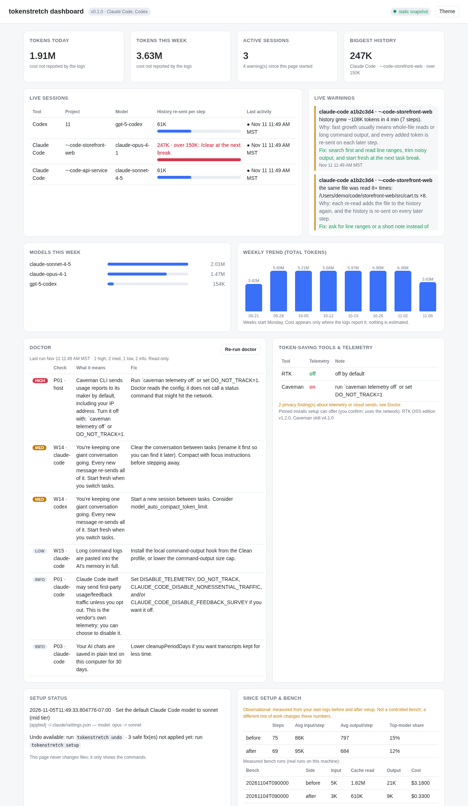

# tokenstretch: technical details

The full guide and implementation notes that used to be in the README. Start with the top-level [README](../README.md).

# User guide

## What you get

- **A plain-English checkup.** `doctor` runs 40+ local checks: the top model set as your everyday default, giant sessions that re-read hundreds of thousands of tokens on every step, duplicate instruction files you pay for twice, telemetry quietly left on, proxy chains, and setups that risk your provider's terms. It also reports saved memory notes that sit in the wrong project's folder, where every session pays to load them. Notes a folder's own recent sessions work with are left out and counted, and the match is by file name only, so check each note before you move it.
- **Fixes it applies for you.** `setup` explains each change (what it is, why it costs you, which file and key it touches, and how to undo it), asks once, then applies it with live progress.
- **A painless fresh start.** `/handoff` has the agent write a short note before you `/clear`, and `/handoff resume` picks the task up in the new session, so clearing a long session no longer costs you the context.
- **A live view.** `status` shows what's applied, which model each tool defaults to, and how much history your newest sessions re-read on every step. It flags sessions over ~150K tokens with a "`/clear` at the next task break" tip.
- **A live watch.** `watch` runs quietly in a terminal and warns you, once per problem, when a session's history gets too big, the top model is doing simple steps, the same file keeps getting re-read, history is growing fast, a conversation or its helpers ran long at a top reasoning effort, or a pause let the saved-context discount expire. On a dearer model the size limits come down with the price. Each warning says what's wrong, why it costs credits, and the one-line fix.
- **A status-bar line.** `statusline` shows the current session's history size and the most urgent warning inside your tool's own status bar, so you don't need a second terminal.
- **An instruction-file trimmer.** `trim` lists every instruction file your agents resend on each turn (CLAUDE.md, AGENTS.md, GEMINI.md, copilot-instructions.md, and their imports) with approx. token counts, finds duplicated rules, oversized files, pasted logs and code, and stale paths, and proposes a trimmed version that only makes safe mechanical changes. It's a dry run unless you pass `--apply`, and `undo` restores it.
- **A brief writer.** `brief "<task>"` turns a one-line task into a brief that names the files, the notes to work from, what not to do again, the stop condition, and the reply length, and lists what your task leaves open.
- **A model and effort picker.** `model suggest "<task>"` recommends light, mid, or top for a task, a reasoning effort to go with it, and names the model for each tool you have. `model default --tier mid` changes your default model, with a backup and undo.
- **A price view per model and effort.** `model cost` weighs your recent sessions' tokens by published price ratios and shows, for each model and effort, where the credits went (history re-read, history saved again, new content, output and thinking) and the one change that removes the most. `model cost --grid` puts the average cost of a step side by side.
- **A team paced through the week.** `queue` hands agents one task per fresh session from a file-based queue, `startup --agent` shows what a worker session can switch off, `model rework` estimates what redo work cost per model and effort, and `pace` holds the team to an even burn of the plan's weekly limit and says how many agents can run at once. See [Run a team at full effort](#run-a-team-at-full-effort) and [Make a week last at full effort](#make-a-week-last-at-full-effort).
- **A shareable report.** `report` writes a single self-contained HTML file with the findings, the plan, what was applied, undo commands, and current status. It loads nothing from the internet.
- **A weekly report.** `report --weekly` adds up your local usage logs per week: tokens by type and by model, your biggest session histories, waste spots, and a before/after view since setup. Cost appears only where your logs report it.
- **A local dashboard.** `dashboard` opens one live page on your own machine with all of the above, updated every 5 seconds. See [Dashboard](#dashboard).
- **Real measurements, never guesses.** `bench` compares before and after on a throwaway copy of your repo, using your agent's own usage logs. If there's no data, it says `no measurement`.
- **An advisor when you ask.** For Claude Code, setup adds a read-only `tokenstretch-advisor` helper. Ask for it and it runs the checks in its own short conversation on the cheapest model, then tells you what is new and what to do first. It changes nothing.
- **Only what is new.** `doctor --new` and `watch` tell you only about findings that are new since the last check, with no model and no credits. See [New findings only, with no model](#new-findings-only-with-no-model).
- **An update you ask for.** `update` shows what changed in a newer release and installs it after you say yes. Nothing checks in the background. See [Update](#update).
- **Full undo.** Every changed file is backed up under `~/.tokenstretch/backups/`, and each change is recorded in a manifest.

## What `tokenstretch start` does

`start` is the one command for someone who just wants it set up. Run with no flags it changes nothing.

1. It checks the computer: the Python version, which supported coding tools it finds, whether the setup steps are already in place, and whether automatic plan readings are on.
2. It lists the changes it would make, one plain line each: the steps `tokenstretch setup` applies by its safe defaults (see [What setup changes](#what-setup-changes-and-how-to-undo-it)), plus switching on [`pace auto`](#make-a-week-last-at-full-effort) when Claude Code is found. It never runs the optional pinned installs, and it downloads nothing.
3. With a person at the terminal it asks `Apply these changes? [y/N]`. Without one (a pipe, CI, an AI assistant's shell) it prints the list and the exact command to apply, `tokenstretch start --yes`, and changes nothing.
4. After applying, or when everything is already in place, it prints up to three plain lines: how much of the plan's week is used, whether that is on track, too fast or with room to spare, and one thing to do next. With no reading yet it says where one comes from.

Running it twice is safe: the second run says it is already set up and changes nothing.

`tokenstretch undo` restores every file the setup steps changed and deletes the files they created. The `pace auto` switch is not a file edit, so it has its own off switch: `tokenstretch pace auto --off`.

| Flag | Effect |
|---|---|
| `--yes`, `-y` | Apply without asking. |
| `--detail` | Also print the full `tokenstretch pace` output. |
| `--compact` | Also turn on [compact mode](#compact-mode-optional). Without it, `start` only mentions the command. |
| `--json` | Print one JSON result (checks, planned changes, whether anything was applied, the plan summary). It never asks and changes nothing without `--yes`. |
| `--home`, `--root`, `--plan` | Same meaning as in `setup`. |

Exit codes: `0` when it finished, including when nothing was changed or you answered no. `1` on a real failure: Python older than 3.11, or a step failed while applying (the message says how to undo what was already done). `2` for a flag it does not know.

## 30-second quickstart

```bash
pip install .                # from a clone of this repo; Python 3.11+, no dependencies
cd ~/your-project
tokenstretch setup           # explains the plan, asks [y/N], applies with backups
tokenstretch setup --list    # the steps available here, each with its id (changes nothing)
tokenstretch setup --only claude-credits-skill   # apply one step; --skip <id> leaves one out
tokenstretch status          # what's on now, plus your newest sessions
tokenstretch report          # writes a local HTML report and prints its path
tokenstretch watch           # live warnings while you work (Ctrl-C to stop)
tokenstretch statusline      # the same checks as one line, for your tool's status bar
tokenstretch dashboard       # live local page in your browser (Ctrl-C to stop)
tokenstretch report --weekly # weekly usage roll-up as a local HTML file
tokenstretch model suggest "fix the flaky login test"
tokenstretch trim            # what your instruction files cost per turn, and a safe trim (dry run)
tokenstretch undo            # restores everything the last setup changed
```

`python -m tokenstretch setup` works too. With no terminal to ask in (CI, pipes), `setup` is a **dry run** unless you pass `--yes`. Use `--dry-run` to preview anywhere.

Sample (trimmed):

```
Plan (3 changes, all local, every file backed up first):
  2. Make sonnet the default Claude Code model
     Why: Your default is opus (from ~/.claude/settings.json). The top model costs several times more per step. ...
     Changes: edit ~/.claude/settings.json (key: model; model: opus -> sonnet)
     Undo: `tokenstretch undo`
     Note: For hard tracing or design work, type `/model opus` in Claude Code, then `/model sonnet` when done.
Apply these 3 change(s)? [y/N] y
✔ switched default model to sonnet, backed up ~/.claude/settings.json → ~/.tokenstretch/backups/…/home/.claude/settings.json
```

## Update

```bash
tokenstretch update
```

It looks at the project's GitHub page for a newer release. When there is one, it lists what changed and asks before it installs anything. Enter means no.

```text
Installed: 0.9.2. Newest release: 0.9.3.
What changed:
[0.9.3] - 2026-11-14
  - `tokenstretch update`: see whether a newer release exists, show what changed, ask, install it.
Release notes: https://github.com/ExJtac/tokenstretch/releases/tag/v0.9.3
Install 0.9.3 now? The release is checked against its pinned commit first. [y/N]
```

- `tokenstretch update --check` only looks. It exits 0 when you are up to date and 10 when a newer release exists.
- `tokenstretch update --yes` installs without asking. `--json` prints one JSON document and never asks.
- The install is the same pinned installer as a first install, run for the folders your copy already lives in. Your settings, hooks and backups are not touched.
- It only changes a copy that the installer put there. A git checkout or any other copy is left alone: update that one the way you installed it.
- Nothing checks for updates unless you run this command. It downloads two public files with `curl` (or `wget`): the installer script and the changelog. It sends nothing about you or your computer.
- On Windows there is no installer script, so it reports the newer release and stops.

## What setup changes, and how to undo it

Setup only proposes a change when it applies to your machine, and it always shows the exact file and key first.

You don't have to take the whole plan. Each step has an id, shown in [brackets] in the plan and by `tokenstretch setup --list`. `setup --only <id>` applies that one step and `setup --skip <id>` leaves one out; both take several ids, repeated or separated by commas. `--only` skips the checkup summary, so it is quick. A step that would start a new file in your project (a `CLAUDE.md` or `AGENTS.md` that doesn't exist yet) is optional: the plan lists it, and it's applied only when you ask for it with `--only`.

| Change | File | Why |
|---|---|---|
| Default Claude Code model → `sonnet` (only if the default is Opus/Fable or unset) | `~/.claude/settings.json` (or the project settings file that sets `model`), key `model` | The top model costs several times more per step. You can still use it for hard work with `/model opus`. |
| 5 short credit-saving rules: start each task fresh, read narrowly, don't re-read, run subagents on the mid-tier model, keep replies short | project `CLAUDE.md` (and `AGENTS.md` if Codex is installed; an existing `GEMINI.md` for Gemini CLI or `.github/copilot-instructions.md` for Copilot CLI, unless Copilot already loads a rules block from `AGENTS.md`/`CLAUDE.md`/`GEMINI.md`), in a marked block. Setup never creates a new Gemini or Copilot instruction file. | Long sessions re-read their whole history on every step. |
| Credit warnings inside Claude Code: the status line, and a prompt hook that shows the top warning in the session (only if they are not already there; an existing status line is kept and wrapped, see [In your status bar](#in-your-status-bar)) | `~/.claude/settings.json`, keys `statusLine` and `hooks.UserPromptSubmit` | Warnings only help if you see them while you work. After this, every Claude Code session shows them with nothing to run by hand. |
| Autopilot for Claude Code: summarize long sessions at about 200K tokens, shape and save the summary, and point a new chat at it (each part only if you haven't set it yourself; see [Autopilot](#autopilot-shorter-sessions-with-nothing-to-type)) | `~/.claude/settings.json`, keys `env.CLAUDE_CODE_AUTO_COMPACT_WINDOW` and `hooks.PreCompact`, `hooks.PostCompact`, `hooks.SessionStart` | Nobody has to remember `/clear`. |
| A `/credits` shortcut for Claude Code (only if no `credits` skill or command exists) | new file `~/.claude/skills/credits/SKILL.md` | The start-up and waste checks without a terminal: the agent runs `startup` and `watch --once` and reports in plain words. After you say yes to one fix, it runs `setup --only <id> --yes` for that step, with the same backup and undo. An older copy written by this tool is updated; a `/credits` of your own is never touched. |
| A `tokenstretch-advisor` helper for Claude Code (only if you have no helper of that name) | new file `~/.claude/agents/tokenstretch-advisor.md` | A credit review when you ask for one: say "use the tokenstretch-advisor helper". It runs `doctor --new`, `watch --once` and `startup` in its own short conversation on the cheapest model and reports to you, not to another agent. It is read-only: it changes no file and no setting, and it cannot edit. Nothing starts it on a schedule. Its one-line description is listed in each session (about 30 tokens); the rest is read only when it runs. Unlike the commands it runs, the helper does use the model. An older copy written by this tool is updated; a helper of your own is never touched. |
| A `/brief` shortcut for Claude Code (only if no `brief` skill or command exists) | new file `~/.claude/skills/brief/SKILL.md` | The brief writer without a terminal; see [Write a brief that stays cheap](#write-a-brief-that-stays-cheap). |
| A `/handoff` shortcut for Claude Code (only if no `handoff` skill or command exists, in your home folder or the project) | new file `~/.claude/skills/handoff/SKILL.md` | `/clear` is the cheapest fix for a long session, but the agent forgets the task. `/handoff` writes a short note first; see [Start fresh without losing the task](#start-fresh-without-losing-the-task). |
| Gemini CLI usage statistics off | `~/.gemini/settings.json`, key `privacy.usageStatisticsEnabled` | It defaults to on and sends usage statistics to Google. |
| Caveman telemetry off | `~/.caveman/cloud.json`, key `telemetry.enabled` | The Caveman CLI reports usage, including your IP, by default. |
| RTK telemetry back off (only if someone turned it on) | `~/.config/rtk/config.toml`, key `telemetry` | Privacy. |
| *Optional, asked separately because it downloads:* pinned installs of RTK OSS v1.2.0 (`RTK_EDITION=oss`, commit `e288a18`) and the Caveman **skill only** v4.1.0 (commit `1e91f13`) | pinned in `tokenstretch/catalog.py` | Shell-output compression and terse replies, from pinned, hash-checked sources. |

To undo, run **`tokenstretch undo`**. It restores every file from the latest setup run, newest step first, and deletes files that setup created. If a JSON settings file (such as `~/.claude/settings.json`) changed since setup, undo does not replace it: it takes out only what tokenstretch added and keeps your later edits (see [Undo when a settings file changed](#undo-when-a-settings-file-changed)). If any other file changed since then, undo stops and tells you, before it writes anything. `--force` restores every file whole from its backup, which discards the later edits. To undo a single step, pass that step's manifest from `~/.tokenstretch/manifests/`.

Shell rc files are never edited. If `ANTHROPIC_MODEL` is set in your shell, setup tells you rather than changing it.

## Watch while you work

`tokenstretch watch` re-reads your local session logs every 10 seconds (`--interval`) and prints a warning the first time a session shows one of these. It never repeats a warning for the same session.

| Warning | Why it costs credits | Fix it suggests |
|---|---|---|
| History over 150K tokens (`--max-context`); lower on a dearer model, see below | Every step re-sends the whole conversation. | `/clear` (fresh start) or `/compact` |
| Top model on the last 3 simple steps (short replies, few tool calls) | The top model costs several times more per step. | `/model sonnet` for routine steps |
| The same file read 3+ times (`--max-reads`) | Each re-read is added to history and re-sent. | Ask for line ranges or a note; start fresh |
| History grew 60K+ tokens in 5 minutes | Big reads or noisy output pile up fast. | Read narrowly, trim output |
| Helpers (subagents) re-sent 1M+ tokens and more than the main conversation | Each helper is its own conversation with its own start-up size, re-sending its history on every step. | One narrow task per helper, name the files to work from, ask for a short reply |
| Finished helpers woke the conversation 3+ times (`--wake-min`) and those steps re-sent 300K+ tokens | Each background helper that finishes starts a new step, and that step re-sends the whole conversation. | Start helpers early and together; one final report, not one per helper |
| 2+ helpers ran at `xhigh` or `max` effort and re-sent 500K+ tokens (Claude Code logs record the effort) | A higher effort lets the model think longer on every step, and thinking is billed as output. | Lower effort for routine helpers; keep the top effort for the hard step |
| The conversation itself ran 15+ steps at `xhigh` or `max` effort and they wrote 60K+ output tokens | Thinking is billed as output, and the effort applies to every step, also the routine ones. | Keep the top effort for the hard step; lower it for routine steps |
| The session started at 40K+ tokens before any work (`--max-start`) | Instruction files, tool and connector definitions, and skill listings are re-sent on every step of every session. `/clear` doesn't remove them. | `tokenstretch trim`; turn off unused connectors and skills (`doctor` W03, W25) |
| The saved-context discount (prompt cache) expired during a pause | The next message re-pays for the whole conversation instead of the discounted re-read. | `/clear` before a break; start fresh instead of resuming a big idle session |

```
⚠ [claude-code abcd1234 · -Users-me-app] history is ~200K tokens (over 150K).
   Why it costs credits: every step re-sends the whole conversation, so each reply now costs at least that much input.
   Fix: finish this step, then type /clear (fresh start) or /compact (keeps a short summary).
```

When the session's start-up size is known, the long-history warning also says about how many more steps it takes for a fresh start to pay for itself: roughly two steps at the current size, divided by what each later step saves (current size minus start-up size). It's a rule of thumb from token counts, not a price calculation.

**Limits follow the price.** Re-reading the same history costs more on a dearer model, so three limits come down with it: history size, fast growth, and helper wake-ups. The yardstick is the mid model. On a model where a re-read costs 2x, the history limit is 75K, not 150K; the floor is 60K however dear the model. The warning names the reason. Cheaper models keep the plain limits, and so do models with no published price ratio in `tokenstretch/cost.py`. A limit you set yourself (`--max-context 200000`) stays as you set it. The status bar line shows the same limit.

**The history limit never sits below a session's own start.** A fresh session is never smaller than its start-up size, so the history limit is at least that size plus half the plain limit. A session that starts at 77K on a model with a 75K limit is warned at about 115K, not on its first step.

The cache warning comes in two forms. If the logs already show it (after a pause of 5+ minutes, the same model re-wrote most of the history to the cache and read almost none back), watch reports how often and how many tokens. If a session with 20K+ tokens of history is sitting idle past the cache lifetime right now (about an hour on a Claude subscription, about five minutes with an API key or a 5-minute cache setting), watch says the discount has probably expired, so you can `/clear` before your next message. That second form is a prediction from the clock, and it says so. Claude Code only for now.

It's read-only and only looks at token counts, model names, tool-call counts, and the paths of files the agent read (never their contents). `--once` does a single pass. `--notify` also pops a desktop notification through your OS's own `osascript` or `notify-send`, if present. Claude Code is fully supported. Codex gets the history, top-model, and growth warnings (its logs don't record file reads). Other tools say "not supported yet".

### New findings only, with no model

`tokenstretch doctor` lists everything it finds, every time. Two ways to hear only about what is new:

- `tokenstretch watch` also runs the doctor checks every 30 minutes (`--checkup MINUTES`, `0` turns it off) and prints a finding the first time it appears. With `--notify` it is also a desktop notification.
- `tokenstretch doctor --new` lists only the findings that were not there at the last `doctor --new`. The first run records a starting point and lists nothing. `--notify` adds a desktop notification, so a scheduled job can run it with no terminal open:

```bash
# every hour, from cron: a desktop notification when a new finding appears
0 * * * * "$HOME/.local/bin/tokenstretch" doctor --new --notify >/dev/null 2>&1
```

```text
1 new finding(s) since the last check:
MED W29 [claude-code]: 3 memory entries in this project's memory folder are named after another project.
  fix: move them to that project's memory folder
  source: ~/.claude/projects/-Users-me-app/memory
```

Both are plain scripts. No model runs, so they use no credits, and the notices go to you: the terminal or the desktop, never into an agent's conversation. What is remembered is one short hash per finding in `~/.tokenstretch/findings-seen.json`: no message, no path. A finding that goes away and comes back counts as new again, and so does one whose severity changes.

### Undo when a settings file changed

Setup writes a settings file whole, so the plain undo is to put the whole backup back. When the file has not changed since setup, that is what happens. When it has (you added a hook, another tool added a key), a whole-file restore would wipe those edits, so undo works key by key:

- A hook or status line that runs tokenstretch is removed. It is matched by its own command string. If setup wrapped a status line of yours, yours comes back.
- A key that setup added is removed, and a key that setup changed goes back to its old value, when it still has the value setup gave it.
- Everything else stays as it is now. That includes a key setup set that you have changed again since: your value is kept.

Undo names each file it handled this way. To tell its own plain keys (a model name, an `env` value) from yours, undo uses a copy of the file as setup wrote it, kept beside the backup under `~/.tokenstretch/backups/<time>/after/` and readable only by you. Setup runs from before this copy existed have none: for those, hooks and the status line are still removed, and other keys setup set (for example `env.CLAUDE_CODE_AUTO_COMPACT_WINDOW` or `model`) are left for you to change by hand. A changed file that is not valid JSON is never rewritten: undo stops, as before.

## Autopilot: shorter sessions with nothing to type

Most people will never type `/clear` or `/handoff`, so `tokenstretch setup` also sets Claude Code up to do the same job by itself:

1. **Long sessions are summarized automatically at about 200K tokens.** Setup sets `CLAUDE_CODE_AUTO_COMPACT_WINDOW=200000` under `env` in `~/.claude/settings.json`. Without it, a model with a large context window can carry several hundred thousand tokens on every step before anything trims it.
2. **The automatic summary is written as a note you could resume from.** A `PreCompact` hook tells the summary what to keep (goal, what's done and how it was checked, files and branch, decisions, next step, open questions) and what to drop (file contents, command output, search results).
3. **The summary is saved** to `.claude/handoff-auto.md` in the project by a `PostCompact` hook. The summary it replaces is kept as `.claude/handoff-auto.prev.md` (one copy, the newest).
4. **The work restarts by itself after a summary.** The same `SessionStart` hook fires after a compaction and tells the agent to carry on with the summary's next step in the same turn, without stopping to report or asking for a go-ahead. Anything waiting on you still waits.
5. **A new chat picks the work up.** A `SessionStart` hook tells the agent where the newest note is (that file, or the one `/handoff` writes) if it's less than 72 hours old. Say anything ("continue", "what's happening?") and the agent reads the note, tells you where things stand in a few lines, and does the next step without asking you to say go. Ask for something else and the note is left unread. Things the note lists as waiting on you still wait. You do have to send that one message: Claude Code doesn't let a hook start the first turn of an interactive chat.

While autopilot is on, `watch`, the status line and the in-session warning stay quiet about long history below the automatic size: no tip to `/clear` by hand contradicts it. A session that is well past that size (it started before setup, so the setting never reached it) gets one tip instead: type `/compact` once.

The three hooks are one command, `tokenstretch auto`. It makes no model calls, reads only what Claude Code passes it, never follows a link when writing, always exits 0, and its hook command ends in `|| true`, so it can't block a session, a prompt, or a compaction. The notes are kept out of commits; see [Handoff notes and git](#handoff-notes-and-git).

Setup leaves your own choices alone: if you already set `CLAUDE_CODE_AUTO_COMPACT_WINDOW`, `CLAUDE_AUTOCOMPACT_PCT_OVERRIDE`, `DISABLE_AUTO_COMPACT`, `autoCompactWindow`, or turned `autoCompactEnabled` off, the size isn't touched. To use a different size, change the number in `settings.json` (Claude Code accepts 100000 to 1000000).

What this costs: each automatic summary is one model step over the history, and a summary keeps less detail than the full history. What it saves: every step after it re-sends a short note instead of 200K or more. This is built on Claude Code's documented settings and hook events; the unit tests cover the hook and setup logic, and the hooks have been watched on one live automatic compaction: a 283K history came back as a 20K summary in the handoff shape, and the note was saved to disk. That session began before the size setting was written, so a compaction at the 200K size, in a session started after setup, has not yet been watched.

## Start fresh without losing the task

Every step re-sends the whole conversation, so the biggest saving is a fresh session. Most people don't take it, because the agent then forgets what it was doing. Setup adds a `/handoff` shortcut to Claude Code that removes that cost:

```text
/handoff           the agent writes .claude/handoff.md: goal, what's done, files changed, decisions, next step
/clear             fresh session
/handoff resume    the agent reads the note and carries on from "Next step"
```

The note is at most 40 lines, written from what the agent already knows (it's told not to read files or run commands for it), so the handoff itself is one cheap step. After `/clear` you re-send a page instead of the whole history.

**The note is also written without you asking.** When the prompt hook reports that the history is long and the `/handoff` shortcut is installed, it asks the agent to write `.claude/handoff.md` at the end of its reply, and to tell you: type `/clear`, then `/handoff resume`. That leaves you one thing to type. Writing the note costs one extra step, at most once every 20 minutes per session. tokenstretch does not run `/clear` for you: a hook cannot run it. The request is not made while the history is in the range that Claude Code's own automatic summary handles (see "Autopilot" above), and it is advice to the agent: an agent can skip it. Covered by tests; how often agents follow it has not been measured.

The shortcut is a manual-only skill (`disable-model-invocation: true`), so it adds nothing to each turn and the agent never runs it on its own. Once it's installed, `watch` and `statusline` say `/handoff then /clear` instead of `/clear`. Setup never replaces a `handoff` skill or command you already have (it does update an older copy that it wrote itself), and `tokenstretch undo` deletes the file. Claude Code only for now. The saving isn't measured yet: it depends on how often you clear.

### Handoff notes and git

The notes live in the project's `.claude/` folder. Two things keep an old note and your commits safe:

- **The note before the last one is kept.** `/handoff` renames an existing `.claude/handoff.md` to `.claude/handoff.prev.md` before it writes the new one (one `mv` command by the agent). When the prompt hook asks for the note, the hook makes that copy itself. The `PostCompact` hook does the same for `.claude/handoff-auto.md` (`.claude/handoff-auto.prev.md`). One copy is kept per note: a third note replaces the oldest.
- **The notes stay out of commits.** The hooks add one line, `**/.claude/handoff*.md`, to the clone's own `.git/info/exclude`. Git reads that file like a `.gitignore`, but it is local to your clone and is never committed, so your tracked `.gitignore` is not edited and your teammates see no change. The line is added when a hook saves a note, asks for one, or finds one at the start of a chat. It is added once.

To commit the notes, put `#` in front of that line in `.git/info/exclude`; tokenstretch sees the line and does not add it again. Limits: a note that git already tracks stays tracked (run `git rm --cached .claude/handoff.md` once), a folder that is not a git clone gets nothing, and `/handoff` typed by hand in a project where no hook has run yet is covered from the next `/clear` or new chat. `tokenstretch undo` does not remove the line; delete it by hand if you want it gone.

## In your status bar

`watch` needs its own terminal. `tokenstretch statusline` puts the same checks where you're already looking: it prints one line with the current session's history size and, if watch would warn, the most urgent warning.

```text
22K/150K history · claude-sonnet-5-5
⚠ 158K/150K history · /clear at the next task break
⚠ 104K/150K history · cache expired after ~50 min idle (~99K re-sent): /clear before breaks
```

For Claude Code, `tokenstretch setup` adds it for you (shown first, backed up, undone by `tokenstretch undo`). If you already have a status line, setup keeps it and wraps it. To add it by hand instead, put this in `~/.claude/settings.json`:

```json
{ "statusLine": { "type": "command", "command": "tokenstretch statusline" } }
```

Already have a status line from another tool, such as Caveman's? A tool has one status-line slot, so share it with `--wrap`. Put your current command inside it:

```json
{ "statusLine": { "type": "command", "command": "tokenstretch statusline --wrap 'bash ~/.claude/hooks/caveman-statusline.sh'" } }
```

The wrapped command gets the same input and prints as before, and tokenstretch adds its line to the end of the first line (`[CAVEMAN] · 22K/150K history · claude-sonnet-5-5`). If the wrapped command fails or takes over 3 seconds, you get the tokenstretch line alone; if tokenstretch has nothing to say, you get the other line unchanged.

Claude Code pipes the session's log path to the command, and `statusline` reads that one file. It only opens a `.jsonl` file inside `~/.claude/projects`; any other path prints nothing. Run by hand, it uses your newest active session. It's read-only unless you have switched `pace auto` on (then it stores plan readings in tokenstretch's own `pace.json`), runs no other program unless you pass `--wrap`, and takes about a tenth of a second. If anything goes wrong it prints nothing and exits 0, so it can't break your status bar. `--max-context` and `--max-reads` work as in `watch`.

### In the session itself

Setup also adds a prompt hook, `tokenstretch nudge`. When you send a prompt and the session has a warning, Claude Code shows it in the chat and passes it to the agent, which is told to finish your request first and then end its reply with a short high-usage note. The note says what is using the credits and where the fix is: the link to your dashboard when it is running on this computer, or the `tokenstretch dashboard` command that opens it. Setup adds the same command as a `Stop` hook, which Claude Code runs when a reply ends. That one prints the note for you only and passes nothing to the agent, so it adds no step. Claude Code's hook reference describes that message field as shown to the user; where an app displays it is up to the app. The Claude desktop app shows it folded under a "Claude Code notice" line that you click to open (seen in November 2026). That is why the agent is still asked to type the note: the typed one shows without a click. If the agent cannot do the fix itself, run `tokenstretch doctor --usage`. It lists each warning for the sessions active in the last 2 hours with why it costs credits and how to fix it, and it changes nothing. This is what makes the warnings reach sessions nobody is watching, such as agents working in the background.

Setup adds the same command a third time, for the moment the agent starts a helper (Claude Code's `Agent` tool). A helper that finishes on its own starts a new step in the conversation that started it, and that step re-sends the whole history. When the conversation's history is about 50K tokens or more, the hook passes the agent a note: start the helpers that belong together in one message, ask each for one short final report, and do not write a status reply each time one finishes. The note is advice to the agent. It does not block the helper or change how it runs, the agent may not follow it, and it is said at most once every 20 minutes per session. Whether it lowers your usage has not been measured.

- No warning, no output, so a clean session pays nothing.
- The same kind of warning is repeated at most every 20 minutes per session.
- It reads the one session log Claude Code names (token counts, never prompt text), always exits 0, and can't block a prompt (the hook command ends in `|| true`, so even a broken install can't).
- It keeps one small file per session in `~/.tokenstretch/nudge/` to remember what it last said. Files older than a week are removed.

## Dashboard

```bash
tokenstretch dashboard            # opens http://127.0.0.1:8765/<one-time key>/ in your browser
tokenstretch dashboard --no-open  # just print the link; --port 9000 to pick a port
tokenstretch dashboard --url      # print the link of the dashboard that is running now
tokenstretch dashboard --remind on|off   # the link reminder (see below)
```

One page, refreshed every 5 seconds while it runs:



- **Overview:** tokens today and this week, cost (only if your logs report it), active sessions, and the biggest history.
- **Live sessions:** tool, project, model, and history size with a bar against the 150K mark.
- **Live warnings:** the same once-per-problem warnings as `watch`, each with its fix.
- **Models this week** and an **8-week trend**, as simple bar charts.
- **Doctor results** with plain-English fixes (re-run with a button; it's read-only).
- **Setup status:** what tokenstretch applied and whether `tokenstretch undo` can restore it.
- **Token-saving tools** found on your machine and whether their telemetry is off.
- **Since setup** (a before/after from your own logs, clearly labeled observational) and **bench results** if you've measured one.
- **Pace**, **team queue**, **cost**, **redo work**, **start-up size** and **watch** panels. Each one reads the same data as its command (`pace`, `queue list`, `model cost`, `model rework`, `startup`, `watch`) and shows a one-line reason when there is nothing to show yet. Cost figures are estimates from published price ratios, not a bill, and the redo-work and start-up numbers are heuristics from your own logs.

The page opens instantly and shows "warming up" while it reads your logs in the background; usage numbers and doctor results fill in as they're ready (seconds on a large log folder, the first time). After that it only reads what changed. `--weeks 8` sets how far back it reads.

It's read-only: it never changes your files, it only shows the commands to run. It writes only inside its own folder, `~/.tokenstretch/`: a link file, `dashboard.json`, while it runs (removed when it stops), and the read caches under `cache/` that hold times, model names and token counts so later reads are fast. It listens on 127.0.0.1 only, needs the one-time key in the link for every request, and loads nothing from the internet. Press Ctrl-C to stop it.

**Link reminder (off until you turn it on).** `tokenstretch setup` offers one extra, undoable item for Claude Code that switches on a reminder. When it is on, the session-start hook that setup already installs adds one line to a new session's starting context, and again after each automatic summary, that asks the assistant to end each finished task with "View your tokenstretch dashboard at <link>" if the dashboard is running, or with the `tokenstretch dashboard` command if it is not. It is a request to the assistant, so whether the line shows up is up to the assistant. It never asks you anything and is meant not to stop the task. The link only ever points at 127.0.0.1. The switch is the file `~/.tokenstretch/dashboard-remind.json`; `tokenstretch dashboard --remind off` (or `tokenstretch undo` after setup) turns it off at once. A link file left behind by a dashboard that crashed is ignored when its port no longer answers.

`tokenstretch report --weekly` writes the same weekly numbers to a self-contained HTML file under `~/.tokenstretch/reports/` (`--weeks 8`, `--out FILE`, or `--json`).

## See what every session starts with

Every session carries a block before you type anything: instruction files, skill and helper listings, and tool and connector definitions. It is re-sent on every step, and a fresh start doesn't remove it. `tokenstretch startup` shows what it is made of.

```text
Claude Code: what every session carries before you type
  Measured: the newest session's first step was ~77K tokens. Recent sessions: 77K, 80K, 75K.
  Price: on claude-fable-5-2, 50 steps re-read this block 50 times. That costs about as much as ~385K new input tokens on the mid model, 2x what the mid model pays for the same block. An estimate from published price ratios, not a bill.
  Sized from local files: ~2.5K tokens (approx., bytes / 4).
    ~  1.3K  instruction file: ~/work/CLAUDE.md
             `tokenstretch trim` removes duplicates and moves reference blocks out.
    ~  0.9K  instruction file: ~/work/app/CLAUDE.md
  The rest, ~75K tokens, can't be sized from local files: the tool's own system prompt and built-in tools, and connector tool lists.
  To size a connector, or what a plugin's connectors add: turn that one thing off, start a new session, and run this again. This command remembers the last run and shows the difference as its size.
```

That output is from a real machine, with paths changed. The instruction files were under 4% of the start-up size, so trimming them would not have helped much there; the connectors and plugins were the place to look. The command exists to tell you which case you are in before you spend time on the wrong fix.

The `Price` line puts the block in price terms for the model the newest session ran on: a re-read is cheap per token, but the block comes back on every step, and a dearer model multiplies it. It appears only for models with a published price ratio.

Sizes are estimates (bytes / 4). Skills marked `disable-model-invocation` are left out because they aren't listed to the model. Instruction files deeper in the project are left out because they load only when the agent works in that folder. `--all` lists every part and `--json` prints the data. Claude Code only for now.

Plugins and skills added by the desktop app are listed too, each with its listing size and the number of connectors it brings. The app also keeps copies of plugins it only offers; those are marked `available` in the app's own `<plugin>.meta.json` and are left out, because no session loads them. The command reads the last 14 days of Claude Code logs on this computer and counts calls to each one. A `No use found in the last 14 days` line names the ones with no call. Read that line with care: it counts Claude Code sessions only, so a skill you use in the desktop app's chat can still be named. A plugin with hooks is never named, because hooks run without a call. The command switches nothing off. For a plugin installed from the terminal it prints the `enabledPlugins` line to set to `false` in `~/.claude/settings.json`. A plugin the desktop app adds is switched off in that app: Settings > Customize > Plugins, change the list from "Discover" to "Yours", then switch the plugin off. Those menu names are from November 2026 and can change. The dashboard's Start-up size card shows the same steps next to each plugin with no use found. A skill the desktop app adds is switched off there too: Claude's help page says to open Customize > Skills and use the switch next to the skill (page read in November 2026; not checked on screen by this tool's authors). The listing sizes are small next to the connectors a plugin brings. Those can't be sized from local files, so they are sized by difference: run `tokenstretch startup`, switch one plugin off, start a new session, and run it again. The second run prints how much lighter sessions start, on top of the plugin's skill listing. A plugin whose connectors are not signed in may add little or nothing, and a change under 2K tokens is treated as noise and not shown.

Connector tool lists aren't in any local file, so they are sized by difference. Each run remembers the unsized remainder for the current set of connectors in `~/.tokenstretch/startup-history.json` (connector names and token counts only). Turn one connector off, start a new session, and run `startup` again: it reports how much lighter sessions now start, and if you turn the connector back on it is listed with that size. The two numbers come from two different sessions, so a change under 2K tokens is ignored and the size is approximate. When the local files and connectors are the same as last time but the start moved by 2K or more, it says so: a plugin or an app connector changed. `--no-save` keeps the run read-only.

## See which connectors you use

A connector (an MCP server) puts its whole tool list into every session, whether you call it or not. `tokenstretch connectors` reads the last 30 days of Claude Code logs on this computer and counts the calls to each one, so you don't have to remember which you use.

```text
Connectors: calls in the last 30 days of Claude Code logs on this computer (212 session files).
    calls  sessions  last call   connector
      340        41  2026-11-12  mail: your user file
       12         3  2026-10-30  browser: added by an app or a plugin, not in a local file
        0         0  -           crm: your user file  <- no call found
        0         0  -           tickets: the tracker plugin (app)  <- no call found
  You can switch off here: crm. Run `tokenstretch connectors off --unused` to see the change, and add `--apply` to make it. `connectors on NAME --apply` brings one back.
  No call found to any connector of: tracker. A plugin's connectors are switched with the plugin; `tokenstretch startup` shows how for each.
```

That is the layout of a real run, with made-up names.

`tokenstretch connectors off NAME` switches a connector off, and `connectors off --unused` does it for every connector in your user file with no call in 30 days. Both only show the change until you add `--apply`. `connectors on NAME --apply` brings one back. A switch takes effect in the next session, because a running session keeps the connectors it started with. After setup, a new Claude Code session is told which connectors are off and the command that brings one back, so the assistant can ask you for it when a task needs one.

What the switch covers, plainly:

- It edits one place: the connectors in your own user file (`~/.claude.json`), the ones added with `claude mcp add --scope user`. `off` takes the entry out of that file and `on` puts it back, unchanged and unread. `~/.tokenstretch/connectors-off.json` lists the names that are off and, for each, which switch backed its entry up. It never holds an entry, so no `env` value, header, URL or argument is in it. This was checked against Claude Code itself: after `off --apply`, `claude mcp list` no longer lists the connector, and after `on --apply` it does.
- A switch is recorded like a setup change, so `tokenstretch undo` reverses it while it is the latest change: the connector goes back to the file it came from. `~/.claude.json` changes all the time, so undo usually works key by key there: only the connector moves, and everything else in the file stays as it is now (see [Undo when a settings file changed](#undo-when-a-settings-file-changed)). `connectors on NAME --apply` and `connectors off NAME --apply` reverse a switch at any time.
- Where an entry is held. A connector's entry can hold an API key, so it matters where copies are. An entry is in `~/.claude.json` while the connector is on. While it is off, the entry is only in the backup of `~/.claude.json` that the switch made, and `on` reads it from there. Each switch keeps, under `~/.tokenstretch/backups/<time>-connectors-NN/`, a copy of both files from before the change and, under `after/`, a copy of both as written. All of these are created readable by you only (mode 0600), and undo keeps the two files that way. The record of the switch in `~/.tokenstretch/manifests/` holds paths and checksums only. No command prints an entry or any value in it. The copies stay until you delete them: remove `~/.tokenstretch/backups/` folders you no longer want to undo, and do that after you change a key that an old copy still holds. Switch a connector on before you delete the backup folder of the switch that turned it off: without that folder `on` has no entry to put back. It then says so, changes nothing, and you add the connector again in the tool itself. An off file written by 0.9.7 or earlier, which held whole entries, is still read; the next switch rewrites it with names only, and the old file goes into that switch's backup.
- Connectors that a plugin, the desktop app or a project file adds are counted and reported, never edited. A plugin's connectors go off with the plugin. The desktop app's are switched in that app's settings.
- A connector is called unused only when at least 5 sessions were found and all the logs could be read. An app's connector shows up only after its first call, since no local file names it. Other apps that share a connector are not counted.
- If a Claude Code session is open while you switch, it can write the old settings back when it closes. Run `tokenstretch connectors` again to check.

## See which tool outputs fill your sessions

Every tool result is added to the conversation: a file read, a command's output, a search, a web page. `tokenstretch outputs` adds up that text for the last 7 days of Claude Code logs, per tool, and lists the largest single results.

```text
Tool outputs: text that tools put into your sessions in the last 7 days of Claude Code logs on this computer (38 session files).
    share   ~tokens    calls  largest  tool
      61%      912k     2140     7.5k  Bash
      24%      359k      188      17k  Read
       6%       90k       61      11k  WebFetch
  Largest single outputs:
        17k tokens  2026-11-12  Read ~/work/app/server/routes.ts
        11k tokens  2026-11-11  WebFetch
  Bash: ask for the end or a count of long output (for example `| tail -40`), not all of it.
  Read: ask for the part you need (a line range) instead of the whole file.
```

That is the layout of a real run, with made-up names and numbers.

It names the tool and, for a file tool, the file. For a shell command it names only the program, never the arguments or the output. Sizes are characters of logged text divided by 4, an estimate; images are not counted. It changes nothing and it cannot tell you whether a smaller result would still have held what the task needed: that part is your call. `--days N` changes the window, `--top N` the length of the list, and `--json` prints the data.

<!-- team: full-effort section -->
## Run a team at full effort

Lowering the effort of a long-running team is not the only way to make a plan's weekly limit last, but be clear about how much the other way buys. On one week of logs from a team that worked mostly on a top model (about 2,100 top-model steps, every log read in full), about 33% of the spend was history re-read, 31% was output and thinking, 30% was new content, and 6% was old history saved to the cache a second time. With no second saves and re-reads halved, that week would have used about a quarter less, which is about 1.3x more work at the same effort (`pace --what-if` shows the same sum for your own logs). So shorter history and a lighter start-up help, and they do not by themselves make a week of top effort without a stop fit in a plan. What keeps the limit from arriving early is a governor on how many agents run at once. The parts:

- One task per fresh session, with no pause. `tokenstretch queue` is a file-based queue in the project (`.tokenstretch/queue/`, one JSON file per task, each holding a ready `brief`), so agents pull work and the lead spends no steps on dispatch.
- A light start-up for workers. `tokenstretch startup --agent` sizes the parts of a session's start-up that it can see in local files (instruction files, skills, connected tool lists) and lists the ones worth switching off for a worker, with the saving over 50 steps in price units. The tool's own system prompt and built-in tools are not in local files, so it cannot size those; on a set-up that loads little of its own it says that no part is worth switching off. It prints settings to use; it writes nothing.
- Proof of what redo work costs. `tokenstretch model rework` estimates, per model and effort, how much spend went to redo steps and what a finished task cost, with four named heuristic signals.

```text
tokenstretch queue add "fix the retry" --files src/upload.py --done "tests pass"
tokenstretch queue add --from-plan plan.md      # one task per numbered step; keeps the file paths and the check each step names
tokenstretch queue next --agent w1              # gate, then claim the oldest open task and print its brief
tokenstretch queue done T0001 --note "ok"       # or: queue fail T0001 --note "what went wrong"
tokenstretch queue list                         # open, claimed, done, needs-lead
tokenstretch queue release --stale 30           # free claims with no update for 30 minutes
tokenstretch queue loop-prompt                  # the standing prompt for a worker session
```

`queue next` checks the pace gate first (`tokenstretch pace --gate`; with no reading stored the gate is open). Over the even-pace line it prints the wait and exits 3; an empty queue exits 4. A claim is a file created with an exclusive open, so two agents never get the same task, and a task whose files overlap a claimed task's files is skipped. `queue fail` sends the task back to open with the note added to its brief, so the next agent does not repeat the mistake; after two failures it is marked `needs-lead` for the lead to look at. The worker's standing prompt ends the session after each task: a fresh short session per task keeps the history small and the cache hot.

`model rework` reads local Claude Code logs, read-only. The signals are a file edited again after a failing test or build, the same file edited 3 or more times, a prompt with a correction word ("still", "again", "wrong", ...), and the steps from a failing check to the next passing one. These are heuristics: a file edited twice may be good work, and the counts are a floor (only the newest part of a long log is read, and edits made through shell commands are not seen). It compares efforts in one sentence only when both have 3 or more sessions, and otherwise says the sample is too small. Units are price-weighted estimates, not dollars and not a bill; models without a published ratio show steps only.
<!-- /team: full-effort section -->

## Trim instruction files

Your CLAUDE.md, AGENTS.md, and similar files are resent on every turn, so a bloated one quietly costs credits all day. `tokenstretch trim` looks at the project you're in (or `--project DIR`) plus your user-level files, and shows what each tool loads per turn:

```text
$ tokenstretch trim --move-blocks
Files:
  ~/.claude/CLAUDE.md  user          ~25 tokens  Claude Code
  CLAUDE.md            project      ~158 tokens  Claude Code
  AGENTS.md            project       ~17 tokens  Codex

Resent per turn:
  Claude Code: ~183 tokens per turn (~18,300 per 100 turns, approx.)
  Codex: ~17 tokens per turn (~1,700 per 100 turns, approx.)

Findings (5):
  MED  duplicate: CLAUDE.md:5 repeats ~/.claude/CLAUDE.md:3 exactly ("- Always run the full test suite before you say a task is d…").
       Why: The same text is already in ~/.claude/CLAUDE.md, which loads in the same turn, so you pay for it twice on every turn in Claude Code.
       Fix: Keep the first copy. trim removes this one.
  MED  big-block: CLAUDE.md:12 has a pasted log (10 lines, ~69 tokens approx.).
  LOW  stale-path: CLAUDE.md mentions 1 path(s) that don't exist in this project: src/legacy/main.py (line 3).
  ...
Proposed edit (safe mechanical changes only: exact duplicates, blank lines, trailing spaces, moved blocks; prose is never rewritten):
  CLAUDE.md: ~158 -> ~81 tokens (-77 approx.)
  create docs/agent-notes/claude-1.md (not loaded each turn; the agent opens it when needed)
--- a/CLAUDE.md
+++ b/CLAUDE.md
...
Dry run: nothing was changed. Add --apply to make these edits (backed up; `tokenstretch undo` restores them).
```

It checks for exact and near-duplicate paragraphs and bullets (within a file, and across files the same tool loads together), files over ~2,000 tokens (`--max-tokens`), big pasted blocks (code over 30 lines, long tables, logs and stack traces, base64 or minified blobs), relative paths that no longer exist in the project, extra blank lines and trailing spaces, and a duplicated tokenstretch rules block. Each finding says why it costs credits and how to fix it.

The proposed edit never rewrites or summarizes your prose. It only removes exact duplicate blocks (keeping the first copy), collapses blank lines, and strips trailing spaces. With `--move-blocks` it also moves big code blocks and logs from project files into `docs/agent-notes/<name>.md` and leaves a one-line pointer. Token counts are approx. (characters / 4), computed from the files themselves. `--apply` asks `[y/N]` (or `--yes`), backs up every file, and `tokenstretch undo` restores them byte for byte. `--json` prints machine-readable output, and the dashboard shows the same numbers in an "Instruction files" card.

`tokenstretch trim --to-skills` is a separate mode for Claude Code. It finds workflow-style sections in your CLAUDE.md files (a numbered list of 3+ steps, a code block of commands, or a heading like "release" or "deploy") and moves each into a skill (`.claude/skills/<name>/SKILL.md` in the project, `~/.claude/skills/<name>/SKILL.md` for your user file), leaving a one-line pointer. Sections that read like standing rules (they mention "never", "always", "private", "security", and similar) stay where they are, and the dry run lists them with the reason. It never overwrites a skill folder that already exists, and `--min-tokens` (default 150) sets the smallest section it will move. The dry run shows the diff and a net per-turn count (tokens removed minus the pointer lines and skill descriptions that Claude Code still loads), all approx. Skills load only when the assistant picks them from their one-line description, so a moved section is no longer guaranteed to be read: keep rules that must hold every turn in CLAUDE.md, and review each description. `--apply` backs up the files, and `tokenstretch undo` restores them and removes the skills it created. It cannot be combined with `--move-blocks`.

## Compact mode (optional)

Compact mode is a short rules block for your project instruction file. It asks the agent for the same answer in fewer tokens. It is not terse or broken speech: the conclusion, the caveats and the next steps all stay. It is off by default.

```sh
tokenstretch compact on        # add the rules to this project
tokenstretch compact off       # take them out
tokenstretch compact           # say whether it is on, and in which file
tokenstretch compact on --dry-run
tokenstretch start --compact   # set up and turn it on in one step
```

The rules:

1. Change files with targeted edits or diffs. Never reprint a whole file to change a few lines.
2. Point to code (`auth.py:40-60`). Quote only the lines under discussion.
3. Don't restate the question, the plan, or earlier messages. No intros, no recaps.
4. Fewer words, never fewer facts: keep the full conclusion, caveats, and next steps.
5. End each finished task with one line: what changed, where, what is next.
6. Hand work to another agent as: goal / done / files / next / open questions.
7. Search first, then read only the line ranges you need.

Where it goes: the project `CLAUDE.md` (Claude Code) and `AGENTS.md` (Codex), which are created if missing; an existing `GEMINI.md` (Gemini CLI) and an existing `.github/copilot-instructions.md` (Copilot CLI), which are never created. A tool that already loads a file with the block does not get a second copy. Nothing is written in your home folder.

If the file already has the credit-saving rules block from setup, the compact rules go inside that block, without rule 7, because the block already says it. So there is one block and no rule twice. The block is paid for on every step, so it is kept small: about 175 tokens alone, about 140 inside the rules block (approx. tokens = characters / 4), and a test fails if it reaches 200.

Each file is backed up before it is changed. `tokenstretch compact off` takes the block out at any time. `tokenstretch undo` right after `compact on` puts the file back byte for byte; after `start --compact`, one `undo` reverses the whole run. A session that is already open keeps the rules it started with; the change applies to new sessions.

What is not known yet: how much this saves. A rules block changes what the agent writes, and the block itself costs tokens on every step, so the net effect has to be measured with the same model on both sides and several runs a side. Until that is done, tokenstretch makes no saving claim for compact mode.

## Write a brief that stays cheap

Most wasted steps start with a prompt that leaves the agent to guess: where to work, what to read, when to stop. `tokenstretch brief` turns a one-line task into a brief that answers those, and tells you what your task text is missing.

```text
$ tokenstretch brief "write the cost page" --files site/cost.py --from research/notes.md \
      --done "the audit prints NO ISSUES" --helper --no-build
Task: write the cost page

Work only in this file: `site/cost.py`. Do not change any other file.

Work from: `research/notes.md`. Read each once. Open another file only when you need its exact lines.

Rules:
- No web search and no new research. If a fact is missing, say so in your reply; do not go looking.
- Search before you read, and read line ranges, not whole large files.
- Do not re-read a file you already read unless it changed.
- Do not run builds, tests, or installs. The caller does that.

Done when: the audit prints NO ISSUES

Reply in under 80 words: what you wrote, file paths, and anything you needed and could not find. No recap of the task.

(about 165 tokens, approx.; suggested model tier: mid, effort: medium, a rule of thumb from `tokenstretch model suggest`)

Nothing missing: files, stop condition, and limits are all stated.
```

Give it a bare task and it lists what's open, each with why it costs credits and the fix: no file named, no stop condition, open-ended wording, several tasks in one, research with no limit (`--max-searches`), no notes to work from. `--check` prints only that list and exits 1 if anything is missing, so you can use it in a script. `--file` reads the task from a file and `--json` prints machine-readable output.

It uses simple local rules you can read in `tokenstretch/brief.py`. It makes no model calls and reads only the text you pass in, never your session logs or past prompts. In one live test, helpers given briefs like this ran 6 to 7 steps and re-sent about 0.4M tokens each; open-ended research helpers in the same project ran 10 to 34 steps and re-sent 0.8M to 3.2M each. Those were different kinds of task (writing against research), so treat it as an illustration, not a measurement.

For research tasks the brief also asks for the full URL and read date of every fact, a mark for read-versus-search-summary, and nothing from memory, and it says to list a gap instead of skipping a topic. `--max-searches` and `--max-fetches` set the caps. `--brief-only` prints just the brief, ready to paste or pipe.

For a review, add `--review`: the helper reads only the named files, changes nothing, and reports one line per problem as `path:line: problem. fix.`. A reviewer keeps every file it opens in its history, so a wide review is costly; `--split 8` prints one brief per group of 8 files, each for its own helper, and `--max-reads` caps file reads.

`--preset` starts from a job shape, so you don't retype the same limits. Anything you pass yourself wins over the preset.

| Preset | For | What it adds |
|---|---|---|
| `build` | building something new from one existing example | follow the one example in `--from` and read nothing else in bulk, at most one helper, run the project's check once, 60-word reply. Suggested effort: medium. |
| `research` | a research helper | 8 searches and 6 page fetches at most, answer only the questions in the task, one output file, 60-word reply. Suggested effort: low. |
| `plan` | planning a job before any edits | write the plan to one file and change nothing else, numbered steps that each name their files and their check, steps small enough for a smaller model at a lower effort, hard steps marked, open questions listed, no builds, 12 file reads at most. Suggested tier: top. Suggested effort: high or above. |
| `design` | visual or layout work | look at the current result at phone and desktop width first, write the direction down before editing, up to 5 reference pages on the web, 200-word reply. Suggested effort: high or above. |

The lint knows the shapes too: `build` with no `--from` example and `research` with no question in the task are both flagged. The shapes come from one live project: a build briefed this way re-sent 2.1M tokens where an earlier, wider brief for the same kind of job re-sent 5.2M, and a research helper given an output file and a list of questions ran 9 steps where an open one ran 24. Two runs each, different subjects, so an illustration and not a measurement. `plan` is how the top model earns its price: it runs once, on the step where a wrong call costs the most, and the steps it writes go to a smaller model at a lower effort. A design job is the opposite case: a tight no-web, 80-word brief is the wrong shape for it, which is why that preset loosens both. With a preset, the output also reminds you to check the session ran at the effort you chose (`tokenstretch model effort --by-session`).

In Claude Code you can skip the terminal: after `tokenstretch setup`, type `/brief add a retry to the upload client`. The agent rewrites the task as a brief with the same parts and lists what is missing. It's a manual-only skill, so it adds nothing to each turn. Unlike the command, `/brief` uses the model, so it costs one short reply.

## Pick the right model

```
$ tokenstretch model suggest "Debug the race condition in the websocket reconnect logic"
Suggested tier: TOP: hard reasoning across many parts; worth the top model for this task only.
Why: +2 mentions concurrency/leak bug (score +2).
Suggested effort: HIGH: one hard signal; worth more thinking for this task.

  Claude Code: opus  (switch now: `/model opus`)
    effort: `"effortLevel": "high"` in settings.json, or start the session with `CLAUDE_CODE_EFFORT_LEVEL=high`

Pick the effort when a session starts: a change in the middle of a session re-sends the history at full price.
```

`model suggest` scores the task with simple rules you can read in `tokenstretch/models.py`: words like architecture, broad refactor, migration, race condition, security, root cause, or a visual redesign push toward **top**; rename, typo, formatting, docs, or a version bump push toward **light**; tests and small fixes lean **mid**; naming many files or a long description pushes up. The same score picks a reasoning effort: **low** for mechanical work, **medium** for everyday work, **high** for one hard signal, **xhigh** for several at once. It never suggests `max`. It makes no model calls. **It's a rule of thumb, not a measured result**, so move up a tier or an effort level if the answer comes back wrong. `--file prompt.txt` reads the task from a file and `--json` prints machine-readable output.

`tokenstretch model effort` reads your newest session logs and shows the reasoning effort they ran at: steps and output tokens per effort level, main conversations and helpers apart. It says so when every step ran at one level whatever the task, when most helper steps ran at high or above, or when `max` was used. It reads only what the tool's own log records (Claude Code today), changes nothing, and `--json` prints the same numbers. `--by-session` adds one line per conversation with the model and effort it was logged at, so you can check that a session you set to a higher (or lower) effort ran at it.

`tokenstretch model cost` answers a different question: where did the credits go, in price terms? Token counts alone hide the price. An output token costs about five times an input token, a re-read from the cache costs a small share of one, and the top model multiplies all of it. This command weighs each kind of token by published list-price ratios, per model and effort, main conversations and helpers apart.

```text
$ tokenstretch model cost
Where the credits went in the 12 newest conversations (local logs, read-only).
1 unit = one new input token on the mid model at list price. An estimate from published price ratios (read 2026-11), not a bill.

claude-fable-5-2, MEDIUM, main conversation: 162 steps, ~7.9M units (53% of all)
    history re-read      25%  (19.8M tokens)
    history saved again  17%  (265k tokens)
    new content          28%  (445k tokens)
    output and thinking  30%  (117k tokens)
    the same tokens on the mid model: ~2.5M units (3.2x less). A smaller model may need more steps, so try it on routine work first.
    biggest lever: replies are the largest part: ask for shorter replies, and for changed lines, not whole files.

claude-sonnet-5-5, HIGH, main conversation: 94 steps, ~1.3M units (9% of all)
    history re-read      49%  (12.3M tokens)
    history saved again   5%  (55k tokens)
    new content          24%  (245k tokens)
    output and thinking  22%  (55k tokens)
    biggest lever: the conversation is long and every step re-reads it: start fresh at the next task break (`tokenstretch watch` says when).
```

That output is from a real machine, shortened. The four kinds: **history re-read** is the conversation coming back from the cache on each step; **history saved again** is old history written to the cache a second time, after a pause outlasted the cache or the model changed mid-conversation; **new content** is what arrived for the first time (files read, command output, your prompts); **output and thinking** is what the model wrote, with its thinking. Each row ends with one lever, picked from its largest kind.

`--grid` prints one line per model and effort with the average cost of a step, dearest first, so a top-model, high-effort session sits next to a mid-model, low-effort one:

```text
model                       effort     steps  units/step  output/step  re-read/step  vs cheapest
claude-fable-5-2            medium       184         47k          731          124k  3.5x
claude-opus-5-5             medium        53         35k           1k          112k  2.6x
claude-sonnet-5-5           medium       119         15k          775          118k  1.1x
claude-sonnet-5-5           high          94         13k          586          131k  1.0x
```

A dearer row is not waste by itself: compare rows that did the same kind of work. Limits to know: units are relative list-price ratios, not dollars, and a subscription plan counts usage its own way. Logs don't say which cache lifetime a save used, so every save is priced at the short-lifetime rate (the one-hour kind costs more). "Saved again" is detected from the pattern (a later step that saves 20K+ tokens and more than it re-reads). Models with no ratio in `tokenstretch/cost.py` (other providers, older models) are listed with token counts only; nothing is guessed. `--sessions N` sets how many conversations are read per tool and `--json` prints the data. Read-only, no model calls.

`tokenstretch model default --tier mid` shows the change to your default model (Claude Code: `model` in `settings.json`). Add `--apply` to make it. The file is backed up first and `tokenstretch undo` restores it. `--tool claude` limits it to one tool. Gemini CLI uses its documented aliases (`flash-lite` / `flash` / `pro`, key `model.name` in `~/.gemini/settings.json`). Codex uses the model ids from its models page (`gpt-6-luna` / `gpt-6.1-sol` / `gpt-6-astra`, the top-level `model` key in `~/.codex/config.toml`; tables such as `[profiles.*]` are left alone). Which models you can use depends on your plan. Codex also lists `gpt-6.1-terra` as a fast light-tier alternative. Copilot CLI uses a recommended mapping (`claude-haiku-5.5` / `claude-sonnet-5.5` / `claude-opus-5.5`, with GPT-6 alternatives), which isn't a list GitHub publishes. If your Copilot model is `auto`, `model default` sets `autoTier` instead (`efficiency` / `balance` / `intelligence`).

## Make a week last at full effort

`queue next` runs the gate for you before it hands out a task.

Lowering the reasoning effort is one way to stretch a plan, and it can cost you in redone work. This is the other way: cut what is re-sent and re-saved (long history, lapsed caches, heavy start-up), and let a governor decide how many agents run at once, so the plan's weekly limit arrives at the reset, not before.

A subscription plan shows percent used per window (5 hours, the week, the week for the top model family) and a reset time. Local logs do not record that percent, so you type it in once in a while. `pace` then calibrates how many price-weighted units one percent is, from the logs since the window began, and tracks the percent from there. On the one account we checked this against (one reading stored, a week of logs), the estimate matched the plan's own card to the point at two later checks within half an hour: 83% then 84% for the top-model week, 61% then 62% for all models. That is one account over a short span, not a promise; add a reading now and then.

To skip the typing on Claude Code, run `tokenstretch pace auto`. Claude Code hands its status line the plan's 5-hour and 7-day limits (percent used and reset time, on a subscription plan, after a session's first reply). With `pace auto` on, the tokenstretch status line stores them as windows `auto-5h` and `auto-week` each time the percent moves a point or half an hour passes. It is off until you switch it on, it stores only the percent and the reset time in `pace.json`, and `tokenstretch pace auto --off` stops it. Claude Code reports no per-model weekly limit there, so keep a top-model window current with `pace set`. This needs a session where the status line runs, which means Claude Code in a terminal. In our check, sessions inside the desktop app stored nothing, and one terminal session stored both windows after its first reply.

```bash
tokenstretch pace set --window weekly-top --used 80 --resets 2026-03-09T09:00:00 --length 7d --models 'fable|opus'
tokenstretch pace set --window weekly --used 60 --resets 2026-03-09T09:00:00
tokenstretch pace                 # where each window stands against an even burn
tokenstretch pace --gate          # exit 0 on or under the line, 3 over it (for a script or a lead agent)
tokenstretch pace --team 8 --effort max
tokenstretch pace --what-if
```

Sample output (a temporary home with synthetic logs, three days into a week). The shares in it come from the synthetic logs; the what-if cut on one real week of logs was about a quarter, not 40%:

```text
$ tokenstretch pace
Pace (estimates): is the plan on an even burn through each window?
Units are price-weighted, 1 unit = one new input token on the mid model. Estimates from local logs and list-price ratios, not a bill.

weekly  (length 7d 0h, resets 2026-03-09T09:00:00Z)
    reading: 60% used at 2026-03-05T09:00:00Z  (1 stored)
    estimated used now: ~60%   share of window gone: 43%   pace ratio: 1.40  (over the line by 20 points; line = time share minus 3 reserve)
    calibration: ~2.4M units per 1% (units since window start / percent used; store a second reading later for a closer fit); ~97.5M units left, ~24.4M per remaining day (4.0 days left)
    about 226 steps left today on claude-fable-5-2 at effort max (~108k units per step)

weekly-top  (length 7d 0h, resets 2026-03-09T09:00:00Z, models /fable|opus/)
    reading: 80% used at 2026-03-05T09:00:00Z  (1 stored)
    estimated used now: ~80%   share of window gone: 43%   pace ratio: 1.87  (over the line by 40 points; line = time share minus 3 reserve)
    calibration: ~1.7M units per 1% (units since window start / percent used; store a second reading later for a closer fit); ~33.6M units left, ~8.4M per remaining day (4.0 days left)
    about 78 steps left today on claude-fable-5-2 at effort max (~108k units per step)

Tightest window: weekly-top (pace ratio 1.87, ~80% used with 43% of the window gone).
```

`pace --gate` prints one line and exits 3 while a window is over its line (the share of the window that has passed, minus a reserve of 3 points; change it with `--reserve`). It exits 0 when you are at or under the line, and also when no reading is stored: missing data never blocks work. `--json` prints `{ok, wait_seconds, window, used, line}`. A lead agent can run it before it starts another agent, and wait when it exits 3.

```text
$ tokenstretch pace --gate
pace gate: over. weekly-top ~80% used (estimate), line 40%; wait about 2d 19h for the line to catch up.
(exit code 3)
```

`pace --team N` measures units per step and steps per hour for the model and effort in your own logs, and says how many agents can run at once on the line and how long each of N agents can work a day. The sample below is a week that is already far over its line, so the answer is small; early in a window, or on the line, it is much larger. When the logs hold no steps at that effort it says so and uses the nearest measured effort, labelled. `--what-if` shows the same week with old history never saved again and re-reads halved, so you can see how many more agent-hours the cuts buy at the same effort:

```text
$ tokenstretch pace --team 8 --effort max --what-if
Team of 8 on claude-fable-5-2 at effort max (estimates, not a bill):
    measured: ~108k units per step, 86 steps per hour, ~9.2M units per agent-hour
    weekly: 0.11 agents at once on the line, 0.33 h a day for 8 agents
    weekly-top: 0.04 agents at once on the line, 0.11 h a day for 8 agents
    so: the line has room for less than one agent working without a stop. 8 agents can each work about 7 minutes a day (tightest window: weekly-top).
What if old history was never saved again and re-reads were halved? (same models, same effort; estimates, not a bill)
    weekly: history re-saved ~20.6M units, re-read ~76.8M units; the cuts remove ~40% of what was used. Estimated used would be ~36% instead of ~60%, 1.68x more agent-hours.
    weekly-top: history re-saved ~20.1M units, re-read ~68.2M units; the cuts remove ~40% of what was used. Estimated used would be ~48% instead of ~80%, 1.68x more agent-hours.
    8 agents: 0.11 h a day now, 0.19 h a day with the cuts (0.04 -> 0.06 agents at once; a day is capped at 24 h).
```

`watch` warns once per window when a stored window is 10 or more points over its line, and is silent with no reading or after the window has reset. Run `pace set` again after each reset.

Limits to know: every number is an estimate from local logs, published price ratios and your own readings. Units are not dollars and this is not a bill; a plan counts usage its own way, so read your plan's percent now and then and add a reading (two readings calibrate better than one). Models with no price ratio are left out of the units and listed, never guessed. For Claude Code every log in the window is read in full, helpers included, each step at its own time; the steps already read are kept in `cache/window-steps.json` under the tokenstretch home (times, model names and token counts, no prompt or reply text), so the first run is slow and later runs read only what the logs gained. For tools whose helper logs carry no times, helpers count in the same share as the main steps inside the window. Usage that is not in this machine's logs (another computer, the web or phone app) is in your plan's percent and not in the units. Your readings are stored in `pace.json` under the tokenstretch home. No network, no model calls.

## Gemini CLI and Copilot CLI limits

Copilot's per-turn usage (for `watch`) only exists when you turn on its local OpenTelemetry file export (`COPILOT_OTEL_FILE_EXPORTER_PATH`); otherwise usage comes from session totals in `~/.copilot/session-state/*/events.jsonl`. Copilot input is read as including cache, per GitHub's `/usage` help and OTel docs. Copilot client telemetry can only be turned off with the `--disable-client-telemetry` flag, so doctor reports it as unknown unless an alias passes it. `bench --bench` reads Copilot's own `--usage-output-file`. `bench --prepare` / `--measure` cover both tools. RTK's hooks for these tools are wired by `rtk init -g --gemini` / `rtk init -g --copilot`, which you run yourself.

# Implementation notes

An open-source, local toolkit that helps people get more out of AI coding credits. It audits waste and terms-of-service risk (`doctor`), measures before/after usage (`bench`), and can apply a small, terms-safe set of local tools (`install`) with an `undo` path.

**Status (v0.9.7):** `doctor`, Clean-profile `install` / `undo`, the opt-in API-key proxy profile (`install --profile api-proxy --proxy headroom|kompressor`; Headroom `--apply` uses a packaged hashed lock (`uv pip install --require-hashes` into `~/.tokenstretch/tools/headroom`); Kompressor apply verifies the release-binary sha256), and `bench` are implemented. Doctor covers W01–W18, T01–T07, and P00–P06. Gemini CLI and Copilot CLI are tier 1; doctor-only adapters cover Cursor, Aider, OpenCode, and Cline. `LIVE-BENCH.md` is the walkthrough: subscription mode (`bench --prepare` then you run the official CLI, then `bench --measure`) is the default, because the kit never copies, symlinks, or opens credential files. Automated `bench --bench` is API-key mode (`claude --bare` with `CLAUDE_CONFIG_DIR`, and `CODEX_HOME` created first) and only passes through `ANTHROPIC_API_KEY` / `CODEX_API_KEY` if you already exported them; values are never read, logged, or stored. Install pins and hashes are packaged in `tokenstretch/catalog.py` (none invented). `install` is dry-run unless you pass `--apply`. Savings numbers come only from measured runs; if there is no data the command prints `no measurement`. Live installs and live headless binaries have not been exercised in this tree (tests use fake runners).

Requires Python 3.11+. Runtime is the standard library only.

```bash
python -m tokenstretch --version
python -m tokenstretch doctor --home PATH --root PATH --sys-snapshot DIR
python -m tokenstretch doctor --privacy --json
python -m tokenstretch bench --from-logs
python -m tokenstretch bench --bench --prompt '…'
python -m tokenstretch start [--yes] [--detail] [--compact] [--json]   # one-command setup: lists changes, asks once; no flags and no terminal changes nothing; exit 0 fine, 1 failure
python -m tokenstretch compact [on|off] [--dry-run] [--json]   # optional compact-mode rules block in the project instruction file; no word: where it is now
python -m tokenstretch install    # dry-run (no writes); add --apply to write
python -m tokenstretch install --apply
python -m tokenstretch install --profile api-proxy --proxy headroom   # dry-run; never part of Clean
python -m tokenstretch undo       # restore the latest manifest under --home
python -m tokenstretch watch [--once] [--interval 10] [--max-context 150000] [--max-reads 3] [--notify]
python -m tokenstretch statusline [--max-context 150000] [--max-reads 3] [--wrap COMMAND]   # reads the tool's JSON on stdin
python -m tokenstretch startup [--all] [--json] [--no-save]   # what a session carries before the first prompt
python -m tokenstretch startup --agent [--json] [--no-save]   # lean profile for a worker agent: what to switch off and what it saves; writes nothing
python -m tokenstretch connectors [--json]                    # calls per connector in the last 30 days of logs; marks the ones with none
python -m tokenstretch connectors off NAME... | --unused [--apply]   # move user-file connectors out (dry-run unless --apply)
python -m tokenstretch connectors on NAME... [--apply]        # move them back
python -m tokenstretch outputs [--days N] [--top N] [--json]  # tool output text per tool, and the largest single results
python -m tokenstretch auto   # hook entry for PreCompact, PostCompact and SessionStart; reads the tool's JSON on stdin
python -m tokenstretch nudge [--max-context 150000] [--max-reads 3]   # prompt-hook entry; reads the tool's JSON on stdin, prints hook JSON or nothing
python -m tokenstretch brief "task" [--files P..] [--from P..] [--done TEXT] [--helper] [--review] [--max-reads N] [--split N] [--no-build] [--rule TEXT] [--preset NAME] [--max-searches N] [--max-fetches N] [--brief-only] [--check] [--json]
python -m tokenstretch model suggest "task" [--file F] [--json]
python -m tokenstretch model cost [--grid] [--sessions 12] [--json]   # where the credits went per model and effort, price-weighted; read-only
python -m tokenstretch model rework [--sessions 10] [--json]   # redo-work estimate per model and effort (heuristic); read-only
python -m tokenstretch queue add "task" [--files P..] [--done TEXT] [--preset NAME] [--hard] | --from-plan FILE   # one task, or one per plan step
python -m tokenstretch queue next [--agent NAME]       # gate, then claim oldest open task and print its brief; exit 3 over the pace line, 4 empty
python -m tokenstretch queue done ID [--note TEXT]  |  queue fail ID --note TEXT   # fail: back to open, needs-lead after 2
python -m tokenstretch queue list [--json]  |  queue release --stale MINUTES  |  queue touch ID  |  queue loop-prompt
# pace (budget governor)
python -m tokenstretch pace set --window NAME --used PCT --resets ISO [--length 7d|5h] [--models REGEX] [--at ISO]
python -m tokenstretch pace clear --window NAME
python -m tokenstretch pace [--window NAME] [--model ID] [--effort E] [--sessions 500] [--json]   # estimates per window; read-only apart from pace.json
python -m tokenstretch pace --gate [--window NAME] [--reserve 3] [--json]   # exit 0 at or under the line, 3 over; 0 when no reading
python -m tokenstretch pace --team N [--model ID] [--effort E] [--json]     # agents at once and hours a day on the line
python -m tokenstretch pace auto [--off]                                    # status line stores the limits the tool reports (off by default)
python -m tokenstretch pace --what-if [--team N] [--json]                   # no re-saved history, re-read halved
python -m tokenstretch report --weekly [--weeks 4] [--out FILE] [--json]
python -m tokenstretch dashboard [--port 8765] [--no-open] [--interval 5] [--weeks 8] [--url | --remind on|off]
python -m tokenstretch model default --tier light|mid|top [--tool claude|codex|gemini] [--apply]
python -m tokenstretch trim [--project DIR] [--max-tokens 2000] [--max-block-lines 30] [--move-blocks] [--apply [--yes]] [--no-diff] [--json]
```

### watch

`tokenstretch/watch.py` is core only. Adapters supply `watch_sessions(ctx, limit)` (per-turn records: timestamp, model, history tokens, output tokens, tool-call count or `None`, and Read-call file paths), `is_top_model`, `model_tiers`, and `model_switch_hint`. Claude Code reads the tail (4 MB) of the newest `~/.claude/projects/*/*.jsonl` main sessions, merges lines on `message.id`, sums `input_tokens + cache_read_input_tokens + cache_creation_input_tokens` as history, and keeps only `file_path` from `Read` tool calls. Codex uses the rollout parser (`token_count` last usage) and labels each session by its recorded working directory (`session_meta.cwd`, else the first `turn_context.cwd`; the date folder only when neither exists); rollouts give no read paths, so the re-read check doesn't apply. Gemini CLI uses its chat records (history = `tokens.input` + `tokens.tool`, which already include cached tokens; tool-call count from `toolCalls`; no read paths). Copilot CLI uses `chat` spans from the local OTel file export only (`gen_ai.conversation.id` groups a session); without it, watch says it is not supported. Only sessions written in the last 2 hours are checked. Each (session file, condition) pair is reported once per run. The growth check measures against the session's own newest timestamp, not the wall clock. `--notify` calls `osascript` (macOS) or `notify-send` (Linux) through `subprocess` with no shell, if present; no network. Defaults: context 150K, top model on the last 3 steps each under 400 output tokens and at most 1 tool call, a file read 3+ times, history growth of 60K in 5 minutes.

Limits left at their defaults scale with price: `WatchConfig.limits(model)` divides the history, growth and helper wake-up limits by `cost.reread_weight(model)` (never below `min_context`, `min_growth`, `min_wake_sent`; never raised for a cheaper model). A limit passed on the command line is used as passed.

### model

`tokenstretch/models.py`: `suggest_tier` adds +2 per top rule hit (architecture/design, broad refactor, migration/rewrite, concurrency/leak, security, hard debugging, performance, distributed/scale), -2 per light rule hit (rename, typo, formatting/lint, docs/comments, version bump, lookup/summary), -1 per mid hint (tests, small fix), +1 for 5+ file names, +1 for 150+ words, and -1 for a short single-target ask. Score ≥ 2 is top, ≤ -2 is light, else mid. It's a heuristic, not a measured claim. `model default` asks each adapter's `plan_default_model(ctx, tier)` for a `SetupItem` and applies it with `setup.apply_plan` (backup + manifest), so `undo` restores it. Claude Code's tiers are haiku / sonnet / opus and it edits `model` in the last settings file that sets it (else `~/.claude/settings.json`). Gemini CLI's tiers are `flash-lite` / `flash` / `pro` (documented aliases) and it edits `model.name` in `~/.gemini/settings.json` (it skips files that aren't plain JSON). Codex and Copilot CLI have no tier map until model names are verified.

### pace

`tokenstretch/pace.py`. State is `pace.json` under the tokenstretch home: per window the length, reset time, optional model regex and up to 20 readings (percent used, time read). A reset time that moves by under an hour is the same period; a later one, a different length, or a lower percent starts the readings over. Units come from `cost.cost_view` over the steps logged inside the window and on matching models; helpers carry no timestamps, so their counts are scaled by the share of the main steps inside the range. Calibration: units per 1% is the slope between the first and newest readings when they differ in both percent and units, otherwise units since the window started over the newest percent; the estimate adds the units since the newest reading. The even-pace line is the share of the window gone times 100 minus the reserve. `--gate` exits 0 when every checked window is at or under its line (or none can be calibrated), 3 otherwise; the wait is the time until the share of the window gone, minus the reserve, reaches the estimate, capped at the reset. `--team` uses units per step (main plus helpers) and steps per hour (main steps that followed another within 10 minutes) of the chosen model and effort, and divides units left by the hours left; a window whose `--models` pattern does not match the model is skipped. `--what-if` removes the "saved again" bucket and halves the "re-read" bucket. `watch` runs the check at most once a minute and only when `pace.json` exists. Estimates from price ratios, not a bill; unpriced models are listed, never guessed.

### trim

`tokenstretch/trim.py` is core only. The file list comes from each detected adapter's `list_instruction_files` (only `always_loaded` files), so tool paths stay in the adapters: Claude Code (user and project CLAUDE.md, `.claude/CLAUDE.md`, ancestors, `@file` imports, and the project's auto memory `~/.claude/projects/<project>/memory/MEMORY.md`, first 200 lines or 25 KB; a CLAUDE.md deeper in the project loads only when the agent works in that folder, so it is not counted), Codex (`~/.codex/AGENTS.md` and the AGENTS.md chain), Gemini CLI (GEMINI.md or the configured `context.fileName`), Copilot CLI (`.github/copilot-instructions.md`, `.github/instructions/*.instructions.md`, AGENTS.md, CLAUDE.md, GEMINI.md), Cursor (`.cursor/rules/*.mdc`, AGENTS.md), and the rest. Files are de-duplicated by resolved path, and each keeps the list of tools that load it. Only files under your home or the project folder are opened; others are counted from their size. Files with credential-looking names are never opened.

Tokens are approximated as `ceil(characters / 4)` and always labeled approx. Per tool, "per turn" is the sum over the files that tool loads, and "per 100 turns" is that times 100. There are no other savings claims.

Each file is split into blocks: headings, paragraphs, bullets (with their indented continuation lines), fenced code, tables, and the tokenstretch rules block (between its markers). Checks:

- **duplicate** (med): a block of 20+ characters whose text (trailing spaces ignored) already appeared earlier in the same file or in a file loaded by at least one of the same tools. User files come first, then project files.
- **near-duplicate** (low, report only): the same words after lowercasing and dropping punctuation and bullet markers, or a `difflib` ratio of at least 0.9 for paragraphs and bullets of 60+ characters (with a length and word-bigram prefilter and a fixed comparison budget).
- **long-file** (med, high over 2×): over `--max-tokens` (default 2,000).
- **big-block** (med): a fenced block over `--max-block-lines` (default 30), a table over 20 rows, a paragraph or fence of 8+ lines where 60% look like log or stack-trace lines, or a line with a 200+ character base64-like run or 500+ characters with almost no spaces.
- **stale-path** (low, report only): `dir/name.ext` mentions in project files that don't exist relative to the project root or the file's folder. URLs, absolute and `~` paths, `..` segments, domain-like first segments, placeholders like `path/to/`, and credential-looking names are skipped without being touched. Existence is checked with `os.path.lexists` only, never by opening, and only for paths inside the project.
- **whitespace** (info): extra blank lines and trailing spaces outside fenced code.
- **rules-duplicate** (med): a second tokenstretch rules block loaded in the same turn.

The proposal only (1) removes exact duplicate blocks, keeping the first copy, and across files only when every tool that loads the later file also loads the file with the kept copy (otherwise it's reported and left alone); (2) collapses blank-line runs and strips trailing spaces outside fences, and drops blank lines at the end of the file; (3) with `--move-blocks`, replaces big fenced code, log paragraphs, and blob paragraphs in project files with `See docs/agent-notes/<stem>-<n>.md when needed (...)` and writes the block verbatim to that file under the project root (`<n>` skips names that already exist). User-level files never get blocks moved, and non-UTF-8 files are never edited. CRLF line endings are kept. Apply goes through `installer.apply_changes` (backup + one manifest with profile `trim`), so `tokenstretch undo` (latest) or `tokenstretch undo MANIFEST` restores the edited files byte for byte, deletes the created notes, and removes the folders it created. The dashboard's "Instruction files" card calls the same analysis (read-only) in its background builder, alongside doctor (every 5 minutes or on request).

`trim --to-skills` (`tokenstretch/trim_skills.py`, core only, cannot be combined with `--move-blocks`) scans only files that Claude Code loads (when another detected tool also reads a file, the planned move says so, because that tool will see only the pointer line): CLAUDE.md files and their `@file` imports, never MEMORY.md, credential-looking names, or files outside the home and project folders. A section is a heading plus everything up to the next heading of the same or a higher level; headings inside fenced code or the tokenstretch rules block are not headings. A section moves only if its body is at least `--min-tokens` approx. tokens (default 150), it looks like a procedure (3+ numbered steps, a fenced block of commands, or a heading with a word like workflow, checklist, steps, release, deploy, setup, testing, debugging), and nothing in it matches a guard word (never, always, must, do not, don't, non-negotiable, secret, credential, private, privacy, security, safety, permission, approve, forbidden, and a few similar). Level-1 headings, a section that is the whole file, a section that holds the rules block, and a section whose skill folder already exists stay put. Guard-word and similar keeps are listed with the reason; when unsure it keeps. The section text is written unchanged under frontmatter (`name`, a one-line quoted `description` under 200 characters) to `<project>/.claude/skills/<slug>/SKILL.md` (user file: `~/.claude/skills/<slug>/SKILL.md`), and the source gets `- <Heading>: use the \`<slug>\` skill.`. A move is dropped when its removed tokens do not exceed its pointer line plus its skill name and description (which Claude Code lists every session), and the net per turn is printed, approx. (characters / 4). Dry run by default. Apply goes through `installer.apply_changes` with the same `trim` manifest, so `undo` restores the instruction files byte for byte and deletes the skill files and the folders this run created. Skills load only when the assistant chooses them from the description, so the output always carries that limit.

### report --weekly

`tokenstretch/weekly.py` is core only. Records come from every adapter's `read_usage_logs`; weeks start Monday in local time; empty weeks are kept; records without a timestamp are counted as undated and left out of every week. Per week it sums uncached input, cache read, cache write, output, and reasoning tokens, overall and per model. Cost is the sum of `cost_usd` from records whose logs report one (Claude `costUSD` / `total_cost_usd` / `cost_usd`, Codex `cost_usd`, host logs), labeled "reported for N of M steps" when only some do, and "not reported" when none do. There is no price table, so nothing is estimated. Top sessions and waste spots reuse `watch_sessions` and `watch.session_warnings` over the newest sessions (not only active ones). "Since setup" compares equal windows (up to 28 days) before and after the earliest recorded setup/install manifest: steps, average input and output per step, and the share of top-model steps. It's labeled observational, not a bench claim. Bench results are shown only from `~/.tokenstretch/benches/*/result.json`, which `bench --measure` now saves beside its prepare manifest.

### dashboard

`tokenstretch/dashboard.py` serves one self-contained HTML page (inline CSS and JS, no fonts, images, or external URLs) and JSON from `http.server` in the standard library. It writes only under `~/.tokenstretch/`: its link file, `dashboard.json` (`tokenstretch/dashlink.py`), removed when it stops (Ctrl-C or `kill`), and the read caches under `cache/`.

Requests never compute anything. A background thread builds the state in three parts and publishes each as soon as it's done: live sessions and watch warnings (every pass, `--interval`, default 5 s; only sessions written in the last 2 hours), usage / setup / bench (at most every 30 s), and doctor (every 5 minutes, or when you press the button, which only sets a flag). The page is static HTML, and `api/state` returns the last published JSON, with `warming_up`, `pending`, and `updated_local` fields the page shows. GC is paused while a part builds (then the survivors are frozen) so a long collection can't stall the HTTP thread.

Extra panels (`tokenstretch/dashboard_panels.py`): pace, queue, cost, redo work, start-up and watch live under `panels` in the state, each built by calling the same function as its command inside its own guarded step with its own refresh interval (pace 60 s, queue 30 s, cost, redo work and start-up 300 s; watch every pass). A failing panel keeps its last result and waits its interval. The page builds them with `textContent` only. The reminder uses `dashlink.reminder_text`, called from the SessionStart branch of `auto`: it needs a safe `session_id`, the switch file `dashboard-remind.json`, and a loopback connect to the link file's port to decide the link is live; a marker per session under `~/.tokenstretch/dashremind/` keeps it to once, and markers older than 7 days are removed.

Log reading is incremental (`tokenstretch/logcache.py`, core only). Each file is cached by (path, inode, size, mtime): unchanged files are skipped, files that only grew are parsed from the saved byte offset (a half-written last line waits for the next pass), and a file that shrank or was replaced is parsed again. Files whose mtime is older than the window (`--weeks`, default 8) are skipped before they're opened, which covers old Codex archived sessions. Lines are filtered with a substring check before `json.loads` (Claude: lines with `"usage"`; Codex: usage, session, model, and token-count markers), so prompts, code, and tool output are never parsed. Adapters opt in with `incremental_logs`, `usage_log_parser(path)`, and `finish_usage_records`. Session tails for watch/status and doctor's per-file log checks (W13–W15, Codex W14) are memoized by the same stat key, so a doctor re-run only reads changed files. `report --weekly` uses the same reader (fresh each run). The Codex fork-replay filter now groups sessions by their first two events and compares prefixes with hashes, instead of comparing every pair step by step.

On a synthetic 1 GB Claude + 2.7 GB Codex home (8-core Linux box): the page and first `api/state` answer in a few ms; usage numbers land after about 9–10 s on the first pass (about 2 GB inside the 8-week window); doctor after about 18 s; later polls take a few ms (max 28 ms while a build runs), and an unchanged usage rebuild takes about 0.5 s.

Security model:

- **Loopback only.** It binds `127.0.0.1` and refuses any other `--host` (exit 2). If the port is busy it binds a free one and says so. `SO_REUSEADDR` is off so it can't share a port with another listener.
- **Per-run token.** Each run makes a random 32-character key (`secrets.token_urlsafe(24)`) and puts it in the URL path: `http://127.0.0.1:PORT/KEY/`. Every request without the exact key (constant-time compare) gets 403, so other local programs' pages and websites you visit can't read it.
- **Host header check.** The `Host` header must be `127.0.0.1` or `localhost` (with or without the port), else 403. That blocks DNS-rebinding pages that resolve their own name to 127.0.0.1.
- **No cross-origin access.** No CORS headers are ever sent, preflight `OPTIONS` is refused, and a request with a foreign `Origin` header gets 403.
- **Headers.** `Content-Security-Policy: default-src 'none'` with only inline script/style and same-origin fetch allowed, `Referrer-Policy: no-referrer` (the key never leaks in a Referer), `X-Frame-Options: DENY`, `Cache-Control: no-store`, `nosniff`. Request logging is off so the key isn't printed per request.
- **What it shows.** Paths under your home are shown as `~/…`, finding text goes through the same secret masking as doctor, and credential files are only ever stat'd.

Tests run the server on 127.0.0.1 with the socket guard narrowed to loopback only. Under `unshare -rn` the `p00_outer` run brings up `lo` (`ip link set lo up`) so they run there too; in a namespace without loopback they skip with the reason `LOOPBACK-UNAVAILABLE` instead of passing silently.

`doctor` changes none of your files. Its only write is its own cache, `~/.tokenstretch/cache/doctor-logs.json`: per-log totals keyed by each session log's inode, size and modified time, so an unchanged log isn't parsed again. A log modified in the last minute is never cached, the file is dropped when the version changes, and `doctor --no-cache` neither reads nor writes it. Exit codes: 0 = clean (or info only), 1 = waste findings, 2 = a ToS or privacy high.

## Privacy guarantees

These are the product guarantees. What is actually enforced in this tree today is listed after the block.

> **Privacy guarantees**
> - **Zero network calls from the kit itself.** `doctor` and `bench` read local files only. The kit has no telemetry, analytics, crash reporting, update checks, or "phone home." The only network traffic is the install step you run yourself, which downloads pinned versions (exact tags, with checksums where upstream publishes them), and `tokenstretch update`, which checks for a newer release only when you run it.
> - **Your prompts, code, and logs never leave your machine because of this kit.** Your agent still talks to your own provider (Anthropic or OpenAI), exactly as it did before.
> - **The default profile ships only tools that run fully local with telemetry off:** RTK (OSS edition; telemetry off by default), the Caveman skill (no CLI, no cloud), Microsoft TokenEconomizer, and ccusage in `--offline` mode.
> - **No credential handling.** The kit never reads, copies, or proxies your Claude/ChatGPT login or tokens, and credential files are never opened. There is no proxy on your subscription login and no MITM certificates. Settings files are different: `~/.claude/settings.json`, `~/.claude.json` and a plugin's `.mcp.json` hold ordinary settings and can also hold an API key (under `env`, or inside a connector's entry). The kit reads those files for the one thing a command needs: which plugins are on, how many connectors a plugin has, the names of your connectors, whether a hook is set. No value from them is kept, logged or shown. `connectors off` and `on` move a connector's entry whole between two files without looking inside it, and [the connectors section](#see-which-connectors-you-use) lists where the entry and its backups are held.
> - **Opt-in only, and loud about it.** Any optional tool that has telemetry or cloud features is off unless you choose it. When you do, the installer turns its telemetry off first and tells you exactly what it would send.
> - **Checkable.** Run `doctor --privacy` to list every setting, env var, and process on your machine that sends data off-box. Run the kit under a firewall or `unshare -rn` and it still works.

**Enforced today:** `doctor`, `trim`, and `bench --from-logs` are local-only and the package imports no outbound network libraries (the dashboard's loopback-only `http.server` is the only socket the kit opens). Tests include an in-process socket guard and a suite run under `unshare -rn` (skipped if that namespace is unavailable). Credential files are stat'd, never opened. `install` is dry-run unless you pass `--apply`. License checks use packaged snapshots (nothing is fetched). Pins: RTK OSS v1.2.0 commit `e288a18c…` (rtk-oss-* assets only, install.sh and checksums.txt sha256 pinned; linux-gnu x64 and Windows arm64 are reported as unsupported oss platforms); Caveman skill-only at tag v4.1.0 / `1e91f1306d…` (copy `skills/caveman` only); TokenEconomizer v0.1.0 / `ec8ff5ec…` (commit-pinned, no assets) with Clean config `microskills=off`, `toolprune=propose`, `loopguard=off`; ccusage@20.0.48 from a pinned lockfile (`npm ci --ignore-scripts --no-audit --no-fund`, `npm_config_update_notifier=false`) plus `ccusage.json` `defaults.offline=true` and a wrapper that always passes `--offline`. Tests never run real install commands or live headless agents. Live `--bench` uses a throwaway copy and never writes the real repo or HOME. The opt-in API-key proxy profile uses packaged pins: Headroom v0.44.0 commit `b21479e0…` with wheel/sdist sha256 and a packaged universal `--require-hashes` lock (`tokenstretch/pins/headroom/requirements.txt`, includes manylinux x86_64 wheel `3b5c7fd2…`); install is `uv venv --python 3.13` then `uv pip install --require-hashes -r <lock>` into `~/.tokenstretch/tools/headroom` (`UV_NO_PROGRESS=1`). macOS below 14.0 is refused (onnxruntime only ships a macosx_14_0_arm64 wheel); the macOS lock was compiled on Linux and has not been install-tested on a real Mac. Claude is pointed at `http://127.0.0.1:8787` (no path); Codex/OpenAI at `http://127.0.0.1:8787/v1`; Kompressor 1.5.14 commit `9e4721ab…` installs the musl or gnu x86_64 release binary and verifies its sha256. Beacon env is always set off (`HEADROOM_BEACON`, `HEADROOM_TELEMETRY`, `HEADROOM_UPDATE_CHECK`, `DO_NOT_TRACK`, `HEADROOM_OFFLINE`) and the start command passes `--no-telemetry`. **Not done yet:** doctor-only adapters for Goose and Devin. See `ADAPTERS.md` for the interface and paths, and `ROADMAP.md` for unverified items.

## Tests

```bash
python -m pytest -q
```

The suite is also run under `unshare -rn` (the `p00_outer` test, or `pytest -m 'not p00_outer'` inside that namespace). Fixtures under `tests/fixtures/` are fake configs and logs. They contain no real secrets. Install and headless tests use fake runners only; they make no network calls.

## Verified vs unverified

- Claude Code settings, CLAUDE.md locations, and transcript dir `~/.claude/projects/**/*.jsonl` follow official docs. Token field names used in the parser are the usual ccusage-style names and have not been confirmed against a live session file in this repo.
- Codex rollout paths and token fields (`$CODEX_HOME/{sessions,archived_sessions}/**/rollout-*.jsonl`, `event_msg`/`token_count`, `token_usage_record`) are **verified-in-source**. Dedupe of repeated totals and forked-session replays follows ccusage (ccusage-only).
- Cline `metrics.inputTokens` already includes cache; uncached input is `inputTokens - cacheReadTokens - cacheWriteTokens` (floored at 0). Legacy Cline `ui_messages.json` `tokensIn` is still flagged **unverified semantics**. A normalized `output` never includes `reasoning`; sources whose output already contains reasoning (Copilot) are split, so the five buckets add up to the total.
- Gemini CLI chat records (`~/.gemini/tmp/<project>/chats/**/*.jsonl`, legacy `*.json`; project path from `.project_root`) and the `stream-json` `result` stats are **verified-in-source** (gemini-cli `chatRecordingService.ts`, `config/storage.ts`, `config/projectRegistry.ts`, `output/types.ts`). `tokens.input` is the API's `promptTokenCount`, which includes `cachedContentTokenCount`; `tokens.tool` (`toolUsePromptTokenCount`) is added on top of input, and `tokens.thoughts` is kept separate from output as reasoning. This is **verified-in-docs** (Vertex `UsageMetadata`: total = prompt + candidates + tool-use prompt + thoughts) and in the pinned gemini-cli source, which copies the fields 1:1.
- Copilot CLI `events.jsonl` `session.shutdown` and `--usage-output-file` field names are **verified-in-source** (CLI 1.0.109 typings). Input including cache read and write, and reasoning being inside output, are **verified-in-docs** for `/usage` and the OTel metrics. The `inputTokens` field comment doesn't say so, so older `events.jsonl` files carry an UNVERIFIED note. Session cwd comes from `session.start` `data.context` or `workspace.yaml` (verified-in-help). OTel `chat` span attribute names are **verified-in-docs**; the file's line envelope is **UNVERIFIED**, so both a plain span and the OTLP JSON envelope are accepted. OpenCode input excludes cache (verified-in-source).
- The product name `tokenstretch` was available on GitHub, npm, and X at the time of the name check (2026-11-10). No trademark search has been run.

## License

MIT for this repository. Third-party tools in the Clean profile, and Headroom / Kompressor in the opt-in API-key profile, are checked against packaged license snapshots (Apache-2.0 or MIT only) before any apply step. Artifact hashes and commits are packaged in `tokenstretch/catalog.py` and `tokenstretch/license_snapshots/`; this tree does not invent checksums. Headroom and Kompressor have license snapshots (Apache-2.0 / MIT) and the artifact hashes quoted in the catalog.
